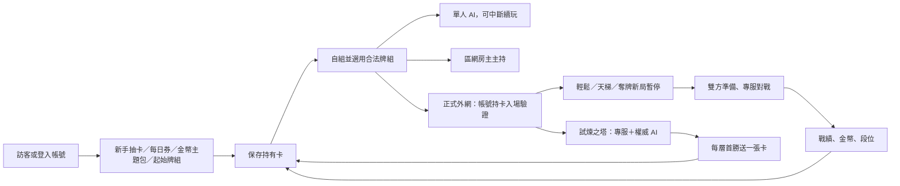

# 🃏 HD-2D 卡牌對戰 — 現行設計與開發進度

> [!abstract] **文件更新與核對說明**
> - **更新日期：2026-10-22，整理版 v2.11。** 遊戲已於 2026-10-16 更名為 **紙鴉牌 / Deckmarch**。發布與部署狀態以 `main` `22f47e50` 的紀錄為準；牌桌視覺修正在分支 `codex/battle-visual-language`（程式到 `8391a2ba`），已推到 GitHub 分支，尚未合併 `main`、尚未發布。
> - **發布現況（R17）：** `2026.10.22-R17`、BUILD `2026102201`、protocol 28。正式專服 2026-10-22 已更新；官網只開放 macOS R17（GitHub `v2026.10.22-r17`），Windows／Linux 熱修中、暫停下載，Android APK 繼續停用。Mac 是 ad-hoc 簽章，未經 Apple 公證。
> - **Android：** Harvey 已在家把 R15 APK 裝到手機，效能可玩、主觀約 60 分（不是量到 60 FPS）。R16／R17 的 APK 都還沒有實機驗收，公開下載維持停用（見[[#D. Android 預覽版：R15 手機可玩、公開下載停用|五-D]]）。
> - **本輪新增（v2.11，涵蓋 10-15 之後約 170 個 commit）：** 起手換牌、投降、要抽牌時牌庫已空即判負、回收改向上取整；三種 PvP、天梯段位、免費金幣與每週獎勵（R14 已部署）；30 層試煉之塔與單人續玩（R17 正式服）；新奪牌局暫停；牌桌視覺語言（分支）。
> - **目前目標：** 2026-11-04 版本凍結與集中試玩（原 10-28，爬塔與續玩併入後延後）。凍結後只修阻擋完賽、資料／權限與錯誤結算。
> - **真正缺少（玩法）：** 特殊召喚、完整反制堆疊、通用移動／退場、PvP 斷線重連、玩家交易、口袋／探索模式；手動分解／合成只有規格。另外有真人整局、實機完整爬塔與其他平台成品待驗收。
> - **保存範圍：** 上半部是現況，下半部「原 v2.0 完整企劃案」原文保留；檔名與 `notion-id` 不變。本輪讀程式、資料與 repo 文件核對，沒有開遊戲視窗、沒有截圖、沒有修改遊戲程式。

> [!tip] **章節快速導航**
> - [[#一、閱讀方式與狀態定義|一、狀態定義]]
> - [[#二、目前遊戲定位|二、遊戲定位]]
> - [[#三、已實作進度表（優先閱讀）|三、已實作進度]]
> - [[#四、現行規則摘要|四、現行規則摘要]]
> - [[#五、尚未完成與原企劃差異|五、未完成與原案差異]]
> - [[#六、可玩性與對局深度診斷（對齊商業 CCG 差距）|六、可玩性診斷]]
> - [[#七、本次核對與後續交接|七、核對與交接]]
> - [[#八、原 v2.0 完整企劃案（設計保留區）|八、原設計保留區]]

---

## 一、閱讀方式與狀態定義

- **① 結論／根本原因：** 找到程式、完成部署、玩家實際驗收是三件不同的事，本文件分開記錄。
- **② 怎麼解：** 每項狀態附目前來源；原設計與現況不一致時列為差異，不直接改回原案。

| 狀態 | 意義 |
| --- | --- |
| **已實作** | 已找到可用程式、資源及入口；不代表本次已重新試玩 |
| **部分實作** | 已完成指定卡牌或部分流程，尚未涵蓋原案全部要求 |
| **未實作** | 在本次核對範圍未找到完整功能及入口 |
| **待驗收** | 已有程式或歷史測試，但缺指定版本的實機／正式服務／真人證據 |
| **待決策／延後** | 原案與現行規則不同，或已有延後決議；不自動列為必須補做 |
| **歷史已部署** | 有指定版本的部署紀錄；不代表目前工作樹的新版也已上線 |
| **來源分支** | 已在功能分支提交並推到 GitHub，尚未合併 `main`，也沒有打包發布 |

- **③ 為什麼這樣解：** repo 的部分總覽仍保留舊版數字；以現行規格、實際程式／資源及有版本的驗收文件交叉核對，避免沿用過時待辦。
- **④ 舉例：** R17 正式服已是 protocol 28，但只有 macOS 成品通過驗收，所以不能寫成「Windows／Linux R17 已發布」。

## 二、目前遊戲定位

- **① 結論／根本原因：** 本作是《紙鴉牌 / Deckmarch》的可玩原型：有收藏、自組牌、三種 PvP、天梯，以及 30 層 PvE 試煉之塔；正式服已上線，但多數平台的新玩家包仍在熱修。
- **② 怎麼解：** 保留「站位、魔力回收、從者／法術與反制」核心；玩家用持有卡自組牌，AI 使用內部主題預組；正式獎勵（金幣、段位、爬塔首通）一律由專服與資料庫結算。
- **③ 為什麼這樣解：** 四路前後排、條件連動與派系效果已能構成準備和兌現；剩餘工作應分成玩法擴充、正式服務驗收與品質（可讀性、平衡、手機）調整，不再把已有功能重做一次。
- **④ 舉例：** 新玩家可先做引導練習、領起始牌組或抽新手卡，選用合法牌組挑戰 AI 或爬塔；外網正式入場由帳號服務驗證雲端持卡。引擎為 Godot 4.7.2：專案預設 Forward+，Windows 預設 Compatibility＋ANGLE，Android 使用 Mobile 渲染器（APK manifest `org.godotengine.rendering.method=mobile`），macOS 走 Metal（R17 修正 RGB8 貼圖在 Metal 上的執行期轉換）。

## 三、已實作進度表（優先閱讀）

- **① 結論／根本原因：** 核心對局、卡池連動、收藏組牌、三種 PvP 與爬塔已落地，正式服已更新到 R17；真人整局、實機與多平台成品仍分別待驗。
- **② 怎麼解：** 以下列出本次找到的入口，不將歷史測試數字當作本次重新執行結果。

| 系統 | 狀態 | 目前具體內容 | 程式／文件依據（repo 相對路徑） |
| --- | --- | --- | --- |
| 對局與資源 | 已實作 | 玩家生命、勝負、四路前後排、魔力成長、暫時回魔與冷卻；要抽牌時牌庫已空即判負 | `src/battle_manager/battle_manager.gd`、`board_layout.gd`、`src/hero/hero.gd` |
| 起手換牌 | 已實作（10-16） | 每人可換零至五張一次，雙方確認才開局；連線由主持端管 30 秒期限，專服只傳自己的手牌 | `src/battle_manager/opening_mulligan.gd`、`docs/fun-review-20261016/mulligan.md` |
| 攻擊與行動 | 已實作 | 可跨路指定前排；活前排保護同欄後排；普攻擇一／獨立攻擊、反擊與召喚暈眩；桌面與手機都能直接拖曳普攻 | `action_target_block_reason()`、`skill_block_reason()`、`card_manager.gd` `BOARD_ATTACK_DRAG_DISTANCE` |
| 投降 | 已實作（10-19） | 正式對戰選單「投降」→ 確認 → 權威端判定對手獲勝；未收到權威確認不先在客戶端判輸；教學保留直接返回 | `docs/gameplay/surrender.md` |
| 條件連動 | 已實作 | 本回合施法、目標狀態、我方場上人數、墓地門檻；副本加值不污染共用卡片 | `src/card/skill_data.gd`、`BattleManager.resolved_skill()` |
| 靈裝與額外技能 | 已實作 | 裝備加成、新蓋舊、宿主離場；破界杖授予額外技能且有獨立次數 | `attach_equip()`、`src/battle_manager/equipment_skills.gd` |
| 瞬咒／伏印 | 部分實作 | 事件式反制、私密揭示選擇、公開觸發演出、宿主規則；沒有通用任意長度回應鏈 | `quick_candidate()`、`trigger_target_ward()`、`src/net/online_battle.gd` |
| 遠程投射物 | 來源分支 | 火球術產生具名投射物，記下已結算的連奏／攻擊加值；只有 BattleManager 扣血，不靠物理碰撞決定命中 | `src/battle_manager/attack_projectile.gd`、`docs/projectile-delivery-20261022.md` |
| 死靈流派 | 已實作 | 二十種新增卡、墓地／放逐、復活、反向治療、骨盾、亡語及法術獻祭 | `src/battle_manager/necromancy_effects.gd`、`docs/necromancy_cards_acceptance.md` |
| 混沌骰術 | 已實作／真人待驗 | 擲骰、爆擊、改骰／重擲、衍生骰靈；雙方可見演出與主持端判定 | `dice_effects.gd`、`dice_presentation.gd`、`docs/dice_presentation_acceptance.md` |
| 法師七派 | 已實作／持續平衡 | 種族結界、鍊金配方、召還、預言／排序、惑控洞悉、鏡像／替身、變形；10-16 起鍊金鍋爐改放受保護的獨立支援區，不佔前後排卡槽 | `mage_core_effects.gd`、`mage_support_effects.gd`、`src/card_slot/alchemy_zone.gd`、`docs/mage_factions.md` |
| 六族與結界 | 已實作 | 六種結界、部族條件、進場／交戰收益、限定換位及破界 | `tribal_effects.gd`、`data/cards/domain_*.tres`、`docs/tribal_factions.md` |
| 單人 AI | 已實作／策略待打磨 | 合法出牌、技能、靈裝、伏印、反制與回魔；10-16 修正出牌順序、站位與回收判斷 | `src/ai/enemy_ai.gd`、`src/card/deck.gd`、`docs/fun-review-20261016/README.md` |
| 試煉之塔 | 已實作／正式服已上線、實機待驗 | 30 層依序解鎖；每帳號每層首勝送一張卡，重打只算練習；每十層提高核心卡密度與 AI 規劃；爬塔房上限兩間，不佔 PvP 的二十間 | `src/tower/`、`src/server/tower_room.gd`、`tower_service.gd`、`docs/tower-r16-handoff.md` |
| 單人續玩 | 已實作／實機待驗 | 一般單人 AI 中途關閉，下次啟動詢問繼續、稍後或放棄；爬塔由專服保存檢查點，斷線不記為輸 | `src/single_player/battle_checkpoint.gd`、`checkpoint_store.gd` |
| 收藏與自組 | 已實作 | 持有量、搜尋篩選、費用曲線、草稿、刪除、選用與合法性驗證；玩家沒有免費預組備援 | `src/collection/deck_library.gd`、`src/ui/deck_builder_panel.gd` |
| 抽卡與每日券 | 已實作 | 零卡新手額度、批次抽卡／開包、稀有度權重、滿三張排除、每包第 5 張至少稀有（R14）、每日券累積與結果保存 | `player_collection.gd`、`pack_definition.gd`、`src/ui/card_pack_panel.gd`、`docs/pack-rare-slot-20261019.md` |
| 玩家成長 | 已實作／R14 已部署 | 免費金幣、金幣主題包、每週包券／自選卡、起始牌組四選一、天梯段位與月賽季；真實付款未啟用 | `src/progression/`、`deploy/account/20261019_progression.sql`、`docs/player-progression-20261019.md` |
| 紙鴉商店 | 介面已實作／後端待部署 | 推薦、文字（二十句鑽石台詞）、金幣卡包；斗篷與卡背只顯示「敬請期待」；沒有儲值或真實付款 | `docs/paper-raven-shop.md` |
| 訪客與帳號收藏 | 已實作／完整流程待驗 | 訪客本機練習；登入帳號走 HTTPS RPC／SQL 權威、持卡入場驗證，失敗不回退成本機發卡 | `src/account/`、`src/collection/collection_service.gd`、`deploy/account/README.md` |
| 多人房間 | 已實作／R17 正式服 | 輕鬆（不奪牌）、天梯（可信票券、Elo）、奪牌（新局暫停）；公開列表、私人房碼、在線人數、快速配對及區網；正式服 protocol 28 | `src/net/net_client.gd`、`src/server/game_server.gd`、`match_room.gd`、`src/net/online_mode_policy.gd` |
| 先後手／後援／空手補牌 | 已實作／平衡待驗 | 隨機先手、後手一次性暫時魔力；自然抽牌空手二張、否則一張；AI 與區網／專服共用規則 | `BattleManager.use_reinforcement()`、`end_turn()`、`docs/opening-balance-20261013.md` |
| PvP 思考時間 | 已實作 | 主持端計時、最後倒數與逾時換邊；PvE 不限時 | `src/net/pvp_turn_clock.gd`、`src/battle_ui/pvp_turn_clock_widget.gd` |
| 戰績與奪牌 | 已實作／新局暫停 | 正式勝敗記錄與重送；奪牌每局雙方重新同意，2026-10-21 起伺服器拒絕新奪牌局；舊戰利品、收據與重送保留 | `match_record_service.gd`、`match_reward_store.gd`、`src/net/online_mode_policy.gd` |
| 新手教學與查閱 | 已實作 | 首戰引導練習（召喚、換回合、攻擊）、遊戲內圖解、卡圖鑑／我的收藏、召喚物與關鍵字說明、墓地與戰鬥紀錄；訪客完成教學可補足 warband 起始牌組 | `src/tutorial/`、`src/ui/player_guide_content.gd`、`effect_glossary.gd`、`src/battle_ui/battle_archive.gd` |
| 玩家信箱 | 已實作 | 禮物與獎勵收據；10-18 改版 | `docs/interface-onboarding-20261015.md`、`docs/qa/mailbox-redesign-20261018/README.md` |
| 載入、設定與音畫 | 已實作／品質待驗 | 分階段載入、繁中／英文、畫質／無障礙、配樂／環境聲、命中／格擋／狀態／死亡回饋；R15 起玩家包先開封面，首次按「開始」才下載素材 | `src/loading/`、`src/settings/`、`src/audio/`、`src/fx/`、`docs/client-content-download.md` |
| 牌桌可讀性與視覺語言 | 來源分支 | 攻血改用古銅武器／紅寶石美術徽章並全場避讓排位；嘲諷、護盾、掩護用不同形狀；狀態圖示最多三枚＋N；羽毛指向線；像素破盾；墓地名稱改成指到／長按才出現；玩家台詞泡泡指向發話英雄；四種衍生物有專屬 sprite | `docs/battle-visual-language-20261022.md`、`docs/qa/battle-visual-followup-20261022/README.md` |
| 場景與美術 | 已實作／尚未完成風格驗收 | 森林、洞窟、冰原及城鎮，地貌／光影／環境粒子；10-19 中央光池與接地陰影；卡圖逐張審查仍有待重繪、校準與缺圖 | `src/environment/`、`docs/art/arena-lighting-20261019/README.md`、`docs/art/card-art-audit-20261012/README.md` |
| 玩家包隔離 | 已實作 | `exclude_filter` 排除 `src/server/*`、`deploy/*`、`tests/*`、`*.pem`／`*.key` 及三組未確認授權素材；R17 macOS 公開附件只有 allowlist 四個檔案，沒有專服或私人檔 | `export_presets.cfg`、`tests/exported_release_test.gd`、`docs/r17-rollout-20261022.md` |
| 玩家包加密 | 已實作 | `encrypt_pck=true`，自編譯加密範本、卡牌／設定 `.res` include filter；R17 macOS 以正式加密模板匯出；Windows／Linux 需在原電腦用原模板重建 | `export_presets.cfg`、`docs/release-encrypted-template-build.md`、`docs/metal-format-hotfix-20261022.md` |
| 掛名與著作權 | 已實作 | 未確認授權素材整組不出貨，遊戲內有「著作權聲明」 | `CREDITS.md`、`assets/licenses/third-party-provenance-20261013.md`、`src/ui/credits_panel.gd` |
| 更新檢查 | 已實作 | 主選單頁尾「檢查更新」；R17 更新 API 只列 macOS，平台暫停時回空清單；手機在清單沒有 Android 時顯示「此平台尚未發布更新」 | `src/release/update_checker.gd`、`release_info.gd`、`src/ui/update_notice.gd` |
| 多平台玩家包 | macOS R17 已發布／其他平台熱修中 | R17 macOS 私有原生與公開首次下載驗收通過；Windows／Linux 要回家用原加密模板重建並原生驗收；R14 曾發三平台桌面包；R16 附件不覆寫 | GitHub `v2026.10.22-r17`、`docs/r17-rollout-20261022.md`、`docs/metal-format-hotfix-20261022.md` |
| 觸控操作 | 已實作（10-21）／新版實機待驗 | 手指移動超過起拖距離就拿起手牌；從者直接拖到目標普攻；短按從者開技能選單；長按看詳情；未選手牌維持約畫面高度 46% 的閱讀大小 | `src/ui/mobile_ui.gd`、`card_manager.gd`、`docs/ui-mobile-20261021.md` |
| Android 預覽版 | R15 手機可玩／公開停用 | R15 主觀約 60 分可玩；10-21 `main` 分包候選核心約 56 MB＋素材約 83 MB，未簽；R17 要用原 keystore 覆蓋安裝 S24 FE 再實機驗收 | [[#D. Android 預覽版：R15 手機可玩、公開下載停用\|五-D]]、`docs/android-main-build-20261021.md` |

- **③ 為什麼這樣解：** 「有六種結界」不等於原案的全場共用領域完全相同；「有種族換位卡」也不等於所有從者都能移動。
- **④ 舉例：** 月汐引流者能將另一名潮民移到同路另一排空格，且保留已用行動；沒有替其他所有卡新增自由換位按鈕。

## 四、現行規則摘要

### 1. 對局、站位與行動

- **① 結論／根本原因：** 現行是四路、自然十魔力與卡面決定的行動選擇；10-16 起加入起手換牌、回收改向上取整，10-19 起要抽牌時牌庫已空即判負。
- **② 怎麼解：** 以現行 `BoardLayout`、`BattleManager`、`opening_mulligan.gd` 與卡面核對下表。

| 項目 | 現行實作 |
| --- | --- |
| 玩家生命與勝負 | 起始 20（`hero.gd` `max_hp`）；對手生命歸零、對手投降，或對手要抽牌時牌庫已空，即獲勝 |
| 棋盤 | 每方四路 × 前後兩排，共八格；全場十六格。鍊金鍋爐放在獨立支援區，不佔卡槽、不參與戰鬥 |
| 普通攻擊目標 | 可跨路指定敵方前排；敵方後排同欄有活前排時受保護。嘲諷等明文限制另算 |
| 直擊英雄 | 檢查攻擊者同路敵方前排及嘲諷；飛行依明文特例，不能穿透後排保護 |
| 自然魔力 | 起始上限零；自己回合開始加一並回滿，上限十 |
| 回收手牌 | 得到 `ceil(Cost / 2)` 暫時魔力（`recycle_mana()`，10-16 起向上取整）；可超過自然上限，自己下回合清除；用後下一自己回合不能再回收 |
| 起手與先後手 | 主持端隨機決定先手，與房主及網路座位分開；雙方起手五張後各可換零至五張一次，換出的牌洗回牌庫，不算抽牌、棄牌或回收；雙方確認才開局。先手開局不另抽，後手首次行動前照常自然抽一張 |
| 後手後援 | 每局一次，後手可在自己的回合按「後援」獲得一點暫時魔力；可保留稍後使用，與回收併用、不算卡牌或施法，下次自己回合開始清除 |
| 自然抽牌／手牌 | 回合開始效果結算後、自然抽牌前空手就抽兩張，否則一張；法術／戰吼照卡面。手牌上限八，溢出入墓；要抽牌時牌庫已空即判負（`draw_cards()`），沒有疲勞傷害 |
| 普攻／技能 | 普攻每回合一次；強化攻擊及標示共同行動的支援與普攻擇一，獨立攻擊保留額外攻擊；一般支援可另用 |
| 召喚暈眩 | 普攻與兩種攻擊型技能當回合不能用，衝鋒例外；非攻擊技能可用 |
| 戰鬥 | 普攻／強化攻擊打從者會受到反擊；獨立攻擊不受反擊；打英雄不受反擊 |
| 靈裝／伏印 | 新裝替換舊裝並收回加成；伏印不佔槽，多數埋於己方宿主，屍變伏印另有敵方宿主規則 |
| 結界 | 每方最多一張，新結界替換自己的舊結界；不是全場共用一張 |
| 思考時間 | PvE 不限時；PvP 每回合一百秒（`LIMIT_MS := 100000`），最後十五秒倒數（`WARNING_SECONDS := 15`）；逾時後完成當前結算再換邊。起手換牌另有 30 秒期限，兩人確認後才開始回合時鐘 |
| 投降 | 正式對戰可確認投降，由權威端判定對手獲勝；不扣英雄生命、不播假死亡 |
| 回合階段 | 有回合開始／抽牌／結束處理與反制窗口；沒有玩家獨立切換 Main／Attack 階段的完整控制介面 |

- **③ 為什麼這樣解：** 同時分清一般規則與卡牌例外，才不會把角色技能、沙盒或派系操作當成所有牌共有能力。
- **④ 舉例：** 劍士選免費三傷普攻，或一魔力連擊兩次各二傷；牧師治療後仍可普攻。回收一費卡現在也能得一點暫時魔力（舊規則是零點）；自然魔力十時，十一費卡至少回收一張二費卡即可支付。

### 2. 卡池與牌組盤點

- **① 結論／根本原因：** 正式卡池仍是 244 種；衍生物在 `main` 是 21 種，視覺分支新增獨立小惡魔後是 22 種。
- **② 怎麼解：** 按 `CardData.card_type` 與 `is_token` 統計，不把衍生物當作可抽正式卡；本次直接數 `data/cards/` 頂層與 `data/cards/tokens/`。

| 卡型 | 正式卡種 | 衍生物／形態 |
| --- | ---: | ---: |
| 從者 MINION | 141 | 10（`main` 9） |
| 靈裝 EQUIP | 9 | 0 |
| 秘術 ARCANA | 67 | 11 |
| 瞬咒 QUICK | 8 | 0 |
| 伏印 WARD | 13 | 0 |
| 結界 DOMAIN | 6 | 0 |
| 設施 SUPPORT | 0 | 1（鍊金鍋爐） |
| **合計** | **244** | **22（`main` 21）** |

| 配套資料 | 現況 |
| --- | --- |
| AI 參考預組 | 十九套（`Deck.PRESET_IDS`），每套二十種、各三張；不代表玩家免費持有 |
| 卡包定義 | 二十六份（`data/packs/`）；商店販售旅者基礎包與九個 `theme_*` 主題包，其餘是新手與舊測試包 |
| 起始牌組 | 登入帳號可一次選領完整主題牌組（六族、死靈、骰術、鍊金，各 60 張）；訪客完成教學可補足 warband 起始牌組 |
| 玩家牌組 | 恰六十張、同 ID 最多三張、不超過持有量；未完成可以存草稿，不能選用進場 |
| 稀有度 | 普通／稀有／史詩／傳說；現行金屬卡框與原案銀金紫配色不同 |

- **③ 為什麼這樣解：** 卡種數、持有張數及預組張數不同；部族標籤也不等同英雄職業選擇。
- **④ 舉例：** 鍊金材料與藥劑有卡片資源及圖鑑內容，但屬衍生牌，由卡牌效果產生，不直接混入一般抽池。完整卡表見[可搜尋卡牌總表](../../repo/card-game-demo-4.5--main/docs/card-catalog.html)。

### 3. 收藏到對局的現行流程

- **① 結論／根本原因：** 已有新手抽卡、每日券、金幣主題包與起始牌組四種取得方式；奪牌新局暫停，爬塔首通是另一條由專服發卡的路。
- **② 怎麼解：** 訪客本機與登入帳號分開處理；金幣、段位與首通只由專服／資料庫結算，客戶端只顯示收據。

| 流程 | 現行規則與限制 |
| --- | --- |
| 新手 | 新訪客／新政策帳號零卡起始，贈送一百五十張單卡抽取額度；批次可選一／十／五十／一百張，剩額可稍後領取 |
| 提早組牌 | 合法持有六十張即可選用進場，不必抽完全部新手額度 |
| 每日 | 每個登入日一張包券，台北日期換日，未花券累積；未登入日不補發 |
| 一般包 | 每包五張、消耗一券；批次可選一／十／五十／一百包；新手剩額歸零才開放一般包 |
| 抽取權重 | 普通／稀有／史詩／傳說 61%／30%／7.2%／1.8%；同級等機率，持有三張者排除。每包第 5 張至少稀有：普通的權重併入稀有，史詩與傳說不變；新手抽每 5 抽的第 5 抽同樣保證。沒有累積保底 |
| 金幣主題包 | 100 金幣立即抽五張入收藏；扣金幣與開包在同一交易，失敗不扣金幣、不發部分卡 |
| 金幣與每週 | 合格正常勝 +40、敗或平 +20（專服確認正常完賽、至少 60 秒且 4 回合；每日 20 場、同對手每日 3 場）；每週 5 局領 1 包券、10 局領 2 包券、20 局領自選一張正式卡的資格 |
| 帳號保存 | 登入帳號的持卡、額度、包券、金幣、收據及正式入場由 SQL 決定；訪客收藏與本機牌組存檔不能作為雲端持有權證明 |
| 奪牌 | 每局雙方重新同意，已開賽後判負失去一張牌；2026-10-21 起伺服器拒絕新奪牌局，舊戰利品、收據與重送保留。重開前要先有 PvP 斷線重連，並處理分身帳號用爬塔卡轉給主帳號的問題 |
| 爬塔首通 | 每帳號每層一張，重送／重打不多發，不給段位、金幣或奪牌；第 1 層 70／20／8／2%，第 30 層 41／20／25.4／13.6%；該稀有度已無可收副本時保留待領資格 |

- **③ 為什麼這樣解：** 舊 R2 的本機每日免費包及 R3／R4「抽完才進場」是版本歷史，不再直接套用目前工作樹。
- **④ 舉例：** 玩家打完一場合格的天梯勝局得 40 金幣，再花 100 金幣可買一個主題包；爬塔第 1 層首勝送一張卡，之後重打只算練習。

## 五、尚未完成與原企劃差異

### A. 原企劃仍未完成的功能

- **① 結論／根本原因：** 原案真正還缺的是特殊召喚、通用回應、交易／口袋／探索層與 PvP 斷線重連；天梯、不奪牌模式與 PvE 爬塔已經補上。
- **② 怎麼解：** 下表保留未完成項目與界線；是否繼續做屬後續決策，本次不新增遊戲機制。

| 功能 | 狀態 | 仍缺什麼／不能混淆的既有功能 |
| --- | --- | --- |
| 獻祭召喚 | 未實作 | 沒有完整 `Sacrifice` 數值、候選資格與補差額召喚入口。禁忌獻儀的犧牲友軍抽牌不等同獻祭召喚 |
| 捨棄召喚 | 未實作 | 沒有依單卡指定捨棄種類、減費／免魔力的召喚流程；棄牌回魔與棄抽已實作，需分開追蹤 |
| 任意長度 Stack | 未實作 | 現有事件反制及選擇流程，尚無雙方反覆加效果、讓過優先權、後進先出結算的通用堆疊 |
| 嚴格五階段控制 | 部分實作／待決策 | 開始、抽牌、結束與觸發已有；Main／Attack 仍可在同回合操作，沒有完整玩家切換階段機制 |
| 通用攻擊範圍／換位／突進 | 部分實作 | 已有保護規則及派系移位，但無通用 `attack_range` 或所有對應關鍵字共用的移動指令；「突進」標記不等於移動已開放 |
| 任意從者主動退場／回收卡槽 | 未完整實作 | 已有召還與特定法術犧牲；沒有所有從者共用的退場按鈕。是否需要，應按實際對局決定 |
| 後手補償 | 已實作／平衡待驗 | 主持端隨機先手，後手每局一次「後援」增加一點暫時魔力；10-16 起雙方都可起手換牌。勝率仍需同版真人量測 |
| 獨立英雄技能／職業限制 | 部分設計／延後 | 七派是卡牌連動，沒有完整英雄選職業與職業卡限制。死靈英雄主動技能、專用盾衛 token、死亡騎士仍未落地，見死靈設計決議 |
| 正式經濟擴充 | 部分實作 | 已有包券、權重、持卡上限、第 5 張稀有保證、免費金幣、每週獎勵與鑽石台詞介面；缺累積保底、真實付款與重複卡轉換。手動分解／合成只有規格：沒有發魔塵、沒有改發牌、沒有部署 API |
| 共通／獨特口袋 | 未實作 | 收藏不是原案具有獨立限制與交換規則的兩種口袋 |
| 非戰鬥咒語卡 | 未實作 | 「同行／磁力／盜竊／黏手指」的探索傳送、搶奪與口袋交換沒有完整入口；戰鬥召還／借咒不能替代 |
| 天梯／積分／排行榜 | 已實作（R14 已部署）／真人待驗 | 黑鐵、青銅、白銀、黃金、白金、鑽石六段；Elo K=24；台北月份為一季，該季完成五局可領最高段位稱號；當月至少五局才上排行榜，只顯示匿名別名。真人外網天梯局尚無紀錄 |
| 獨立不奪卡自由對戰 | 已實作 | 輕鬆對戰不奪牌、不動段位；天梯也不奪牌 |
| 拍賣／玩家交易／自由賭場 | 未實作 | 奪牌是每局同意的勝者選牌，且新局已暫停；仍沒有交易撮合、拍賣或事先押注 |
| PvP 斷線重連 | 未實作 | 爬塔已有專服檢查點續接、單人 AI 可本機續玩；PvP 斷線仍結束對局。檢查點格式預計沿用到 PvP 重連，也是重開奪牌的前提 |
| 無名者暗巷 | 未實作 | 匿名斗篷、多人探索地圖、迷霧、隨機迷宮、碰撞決鬥、出口、衛兵、寶箱陷阱及鏡像 NPC 模式均未落地 |
| 大型世界觀／戰役 | 部分設計 | 六族與法師已有原創設定和規則；試煉之塔是三十層 PvE 挑戰，不是可探索世界、完整劇情或角色職業成長 |

- **③ 為什麼這樣解：** 不同機制需要自己的成本、入口與結算；表面同名不能當作完成證據。
- **④ 舉例：** 霧幕替身是伏印，讓鏡像承受攻擊；它不是暗巷中模仿玩家牌組、具掉落經濟的鏡像 NPC。

### B. 已有功能，但仍缺驗收或品質收尾

- **① 結論／根本原因：** 現在最接近交付的缺口是 11/4 凍結前的真人整局、實機與多平台成品，以及戰場可讀性與平衡，不是再加一批基礎功能。
- **② 怎麼解：** 將可查證的部署與本機新版分開，不自行宣稱正式環境已追上工作樹。

| 工作 | 目前證據 | 還需完成 |
| --- | --- | --- |
| 同版客戶端／專服／SQL | R17 正式服 protocol 28（2026-10-22 04:02 UTC 啟動、04:02:29 就緒）；正式 ENet／RPC 握手、暫停奪牌拒收、爬塔 30 項 SQL 交易（模擬角色、合成檢查點）PASS；macOS R17 成品對正式服驗收通過 | Windows／Linux R17 原生重建與驗收；真實 JWT／HTTP、實機完整爬塔、等待過期、併發與耐久性未驗 |
| 真實帳號流程 | R3-S150 有 OTP 郵件投遞紀錄；R14 起成長資料表與函式已在正式庫 | 玩家輸入驗證碼登入、雲端抽卡、組牌、兩個正式帳號完整對局、金幣／段位收據同步 |
| 跨裝置與訪客綁定 | 帳號收藏 RPC 已有；訪客本機與雲端分開 | 實際跨裝置登入一致性待驗；訪客進度合併／綁定未完成，不能直接上傳本機卡量 |
| 斷線恢復與伺服器營運 | 爬塔：專服 lease、檢查點，服務異常 75 秒停止新行動、最遲 90 秒可續接；單人 AI 本機續玩；房間上限 PvP 20、爬塔 2 | PvP 斷線重連未做；伺服器上 AI 每步決策時間、多間爬塔房時的 PvP 延遲尚未量測（11/4 條件） |
| 對局平衡與 AI | 10-16 樂趣審查：74 場 AI 對局中牌組常沒玩出自己的機制，AI 出牌順序、站位與回收已修；10-21 統計 72 局 1,151 次秘術／結界施放：被反制 9%、有反制卻沒魔力 24%、手上沒反制 66% | 比較「預組多放瞬咒」與「AI 保留反制魔力」；收集先後手勝率與真人回報；不填虛構勝率 |
| HD-2D 精美程度與可讀性 | Harvey 10-21 手動試玩看不清敵方攻血、嘲諷與護盾；分支已改攻血美術徽章與常駐狀態，Forward+ 與 Compatibility 擷取檢查各 1447 項 PASS（Mac） | 手機實際讀字、真人能否看懂、美術最終認可；仍不能宣稱達到《歧路旅人》九成或商業品質 |
| 音訊與操作品質 | 配樂／環境聲／戰鬥回饋、雙語與無障礙設定已有；10-21 手機改直接拖曳 | 真人聽感、音量與光強接受；R15 之後的手機操作沒有實機；控制器未實作；資源釋放與長時間執行仍需按版本複驗 |
| 資訊安全 | `tcg_private` 全表開 RLS，讀取政策為 `auth.uid() = account_id`；`tcg_open_packs` 等 SECURITY DEFINER function 的帳號取自 `auth.uid()` 而非參數，並設 `search_path = ''`；client 只帶 publishable key 與服務網址（設計上公開） | R5 期間 `TwilightCodex-Server-*.tar.gz` 曾公開掛在 Release（已移除）；R14 與 R17 的伺服器包都沒有放公開附件 |

- **③ 為什麼這樣解：** 「已部署」只能描述有版本證據的服務；資料庫交易用模擬角色通過，也不代表玩家實際登入與完整爬塔已驗。
- **④ 舉例：** 正式爬塔的 SQL 測試在同一個 session 裡模擬 authenticated／service_role，檢查點是合成文字；它證明首通只發一次，不證明手機上能爬完一層。

### C. 已改規則，不再當作未完工

- **① 結論／根本原因：** 原案與實裝不同不必然是缺功能，先保留差異與決策依據。
- **② 怎麼解：** 以下使用現行實裝，不自動按原企劃改回。

| 原案／舊文件 | 現行實作 |
| --- | --- |
| 五路 | 四路前後排；已是明確改版 |
| 舊整理版自然魔力七 | 已改十，與原 v2.0 自然上限一致 |
| 所有從者普攻＋技能兩動 | 依卡面分共同行動、獨立攻擊及支援；另有裝備技能次數 |
| 領域全場只存在一張 | 每方一張種族結界；共有六種正式卡 |
| 普通銀／稀有金／史詩紫 | 現行四級稀有度與金屬框／光效，需保留設計差異，不稱原色碼已照搬 |
| 現在不做抽卡／玩家用隨機牌組 | 已有新手、每日券、權重與收藏自組；隨機全卡池混編不再是玩家正式入口 |
| 回收 `floor(Cost / 2)`（v2.10 以前） | 10-16 改為 `ceil(Cost / 2)`，結算、AI 與拖曳提示共用同一個函式 |
| 牌庫不足只抽剩餘、無疲勞（v2.10 以前） | 10-19 改為要抽牌時牌庫已空即判負；單純空手或空牌庫不會判負 |
| 原案「不賭卡」獨立模式 | 由輕鬆與天梯兩種不奪牌模式取代 |

- **③ 為什麼這樣解：** 把規則變更錯列為未做，會要求工程恢復已淘汰的流程。
- **④ 舉例：** 「補領域卡」不再是待辦；若要改成雙方共用全場一張領域，應視為新的規則決策。

### D. Android 預覽版：R15 手機可玩、公開下載停用

- **① 結論／根本原因：** R15 APK 已在 Harvey 的手機上達到可玩，主觀約 60 分（沒有量 FPS）；之後的 R16／R17 改了協定與功能，新版 APK 都還沒在手機驗過，所以公開下載繼續停用。
- **② 怎麼解：** 依 R17 發布順序：用原 keystore 覆蓋安裝 S24 FE → 驗一般單人關閉重開、爬塔斷線續接、切帳號、首通與重打、挖孔安全區與觸控捲動 → Harvey 另行授權後才開放下載。
- R15 是 `2026.10.19-R15`、BUILD `2026101902`、protocol 27；正式服現在要求 protocol 28、最低 BUILD `2026102101`，所以 R15 已無法連正式服。
- 10-21 `main` 分包候選：核心 APK 55,929,181 bytes（約 56 MB）＋首次下載素材 82,691,944 bytes（約 83 MB），總下載 138,621,125 bytes；未簽，因為這台 Mac 沒有原 keystore。
- 簽章：原簽章在 Windows 電腦；新版必須用同一份簽章才能覆蓋安裝，遺失時已裝玩家要先解除安裝，本機資料會消失。

| 關卡 | 現況 |
| --- | --- |
| R15 手機效能 | Harvey 回報可玩，主觀約 60 分；不是 60 FPS 量測 |
| R16／R17 APK 實機 | **NOT RUN**；R15 回報不能代替爬塔、續玩與新版操作 |
| 正式簽章 | 原 keystore 在 Windows 電腦；10-21 Mac 候選未簽；GitHub R16 APK 的 v2／v3 簽章有效，但沒有比對是否與歷史憑證相同 |
| 公開下載 | 官網與更新 API 都不列 Android；GitHub R16 發布頁仍掛著那份 APK，核心／素材缺檔，不能視為可發布 |
| 成品聯集 | R16 已上傳的 macOS／Android 核心加素材缺地面 shader include；R17 macOS 重建後 7540 項聯集檢查通過，Android 尚未用 R17 重建 |

#### APK 大小

| 階段 | APK | 包內卡圖 | 包內頭像 |
| --- | ---: | ---: | ---: |
| R9（已發布，暫停下載） | 463.81 MB | 354.74 MB | — |
| R10 縮到 1024 px、無損 | 302.97 MB | 194.66 MB | 19.78 MB |
| R10 有損 0.9＋頭像 384 px | 121.87 MB | 31.26 MB | 2.07 MB |
| 10-21 `main` 分包（核心＋首次下載素材） | 55.93 MB＋82.69 MB＝138.62 MB | 另載 | 另載 |

#### 歷史紀錄：R9 實機失敗與 R10 修正（保留 2026-10-15 狀態）

以下是 v2.10 的原始盤點：R9 APK 是桌面版直接匯出，2026-10-15 實機試玩時對局卡到手機停住、畫面模糊、無法截圖、捲動區滑不動。「R9 證據」的行號以 `8ec17cff` 為準，「進度」依 `01653863`（`2026.10.15-R10`）；之後的觸控規則已在 10-21 改成直接拖曳，以上方現況為準。

| # | 問題 | R9 證據 | 進度（`01653863`） |
| ---: | --- | --- | --- |
| 1 | 開局把全部卡圖載入記憶體，而且整局不釋放 | `deck.gd:78,91,135`、`battle_manager.gd:188` | **已修（程式）**：Android 匯出把 `CardData.art` 換成 `deferred_art_path`，只有顯示中的卡面載入；成品稽核 265 張按需解碼後釋放。實機記憶體未量 |
| 2 | 卡圖無損匯入、沒有縮小版、長邊 1392–1536 px | 卡圖 `.import`；APK 內卡圖沒有 `.etc2` 版本 | **已修（程式）**：Android 副本長邊 1024 px，Godot 有損 WebP 品質 0.9，全尺寸最低 PSNR 35.1 dB；包內卡圖 354.74 → 31.26 MB。肉眼畫質未驗 |
| 3 | 預設畫質「中」太重：原生解析度、MSAA 2×、FXAA、陰影 4096 | `app_settings.gd:36` | **已修（程式）**：手機關 FXAA，MSAA 只留給高畫質，陰影 1024／2048，預設 30 FPS 上限、可選 60 |
| 4 | 景深模糊在 Android 開啟，畫面霧 | APK `rendering.method=mobile`；`main_scene.gd:26` | **已修（程式）**：手機關閉近／遠景模糊 |
| 5 | 按返回鍵 App 直接關閉 | APK 沒有 `quit_on_go_back` | **已修（程式）**：`config/quit_on_go_back.android=false`；返回先關詳情／指令，再進離開確認 |
| 6 | 遊戲內無法截圖 | repo 沒有 `FLAG_SECURE` | **待實機**：回報為「無反應／卡住」，可能與記憶體有關，修完要重測 |
| 7 | 捲動區滑不動 | `ScrollContainer` 內的按鈕吃掉手指拖曳 | **已修（程式）**：手指從按鈕開始也能捲，滑動不會誤選；隱藏捲軸 |
| 8 | 提示文字寫右鍵／Esc | `battle_ui.gd:863`、`player_guide_content.gd:138` | **已修（程式）**：對戰提示、教學內容與插圖改為手機文案 |
| 9 | 牌組編輯、圖鑑看詳情只能右鍵 | `deck_builder_panel.gd:314,686`、`card_gallery.gd:132` | **已修（程式）**：手機點卡先看詳情，另按「加入選定卡牌」才改牌組；圖鑑每張卡有詳情按鈕，每頁 12 張 |
| 10 | 字太小：最小 13 px，約 1.2 mm | `battle_ui.gd:865,1940`、`card_gallery.gd:366` | **部分**：對戰提示 13→18 px；圖鑑徽章、戰鬥紀錄等 13 px 未改，卡面文字不跟 `ui_scale` |
| 11 | 畫面左右黑邊，每邊約 210 px | APK 沒有 `stretch/aspect` | **已修（設定）**：`window/stretch/aspect.android="expand"`；20:9 版面截圖未驗 |
| 12 | 不是全螢幕 | 預設視窗模式 `app_settings.gd:35` | **已修（設定）**：`window/size/mode.android=3`；實機未驗 |
| 13 | 切到別的 App／鎖螢幕 | `card_manager.gd:890` | **部分**：背景降幀率、保存匿名統計、取消未送出的拖曳；當時沒有對局存檔（R16 起有單人續玩與爬塔續接） |
| 14 | 指令按鈕 34 px（約 3.1 mm）；牌桌格子約 5×3.7 mm | `battle_ui.gd:1238`；格子為電腦截圖目測 | **部分**：手機指令按鈕 80 px（約 7.4 mm），指令面板改到角色附近，加大觸控落點容錯；手感待實機 |
| 15 | 拖曳門檻 12 px（約 1.1 mm），也會打斷長按查卡 | `card_manager.gd:59,927` | **已修（程式，後已改版）**：當時改為手牌短按看詳情、向上 36 px 才出牌；10-21 再改為直接拖曳 |
| 16 | 設定頁有視窗模式、解析度等電腦選項 | `settings_panel.gd:15,109` | **已修（程式）**：手機隱藏視窗尺寸選項，改顯示 30／60 FPS |
| 17 | 主選單有「離開遊戲」 | `main_menu.gd:707` | **已修（程式）**：手機隱藏 |
| 18 | 遊玩統計把 Android 記成 `unknown` | `guest_play_analytics.gd:78` | **已修**：客戶端與 Supabase allowlist 都接受 Android；正式資料庫已套用 migration 並驗證 |

v2.10 的「發布前關卡」（正式簽章、模擬器、S24 FE、20:9 截圖、R9 桌面包白塊推論、OFL 換行稽核）已由本節上方的表取代；當時的尺寸換算假設為 6.4 吋 20:9 手機、1 基準像素約 0.093 mm。

- **③ 為什麼這樣解：** 自動測試只證明邏輯，白塊是在模擬器實際執行才發現的；手機跑不跑得動、看不看得清楚，只能在實機確認。
- **④ 舉例：** R15 在手機上可玩，不代表 R17 的爬塔續接或直接拖曳在手機上正常；新版要重新安裝驗收。已確認沒問題的部分：連線走 HTTPS 與 ENet、存檔用 `user://`、已鎖橫向、區網用手動輸入 IP，不需要額外權限。

## 六、可玩性與對局深度診斷（對齊商業 CCG 差距）

- **① 結論／根本原因：** 舊診斷中的「完全沒有 combo、抽濾與自組牌」已失效；現在最有證據的三個問題是：牌組機制常沒被玩出來、AI 幾乎不反制，以及斜視角戰場讀不出公開數值。
- **② 怎麼解：** 改用現有卡組與操作找問題，不從未量測數據推導勝率或畫面品質。

| 舊診斷 | 現在應怎麼看 | 建議下一步（不構成新增實作授權） |
| --- | --- | --- |
| 隨機大雜燴，沒有套路 | 已有玩家自組、AI 主題預組、四種通用條件與多套派系連動 | 檢查每派準備牌、收益牌、補牌與終結方式是否完整；避免少數無條件高傷蓋過全部連動 |
| 沒有過牌，第五回合必然枯竭 | 已有抽牌／窺視／棄抽／排序、條件戰吼與派系補給；空手自然抽兩張；起手可換牌 | 量測手牌耗盡時點與可用操作，再調補牌；不沿用未驗的「必然」結論 |
| 前排卡死，不能移位 | 已有召還、潮民換排、風暴城調度、特定犧牲與變形 | 先看實戰是否仍卡死，才決定加入所有從者通用的退場或移動 |
| 前期人人雙攻 | 已重配低費共同行動，保留少數高費／稀有獨立攻擊及低傷例外 | 特別檢查固定傷、連擊、反擊與額外裝備技能加總後的每回合收益 |
| 後手必定大幅劣勢 | 已加入隨機先手、一次性後援與起手換牌，尚無版本化先後手勝率 | 量測新規則下雙方勝率、後援使用回合及收益，再調整補償量 |
| 缺乏翻盤效果 | 已有復活、群體清場／治療、骰術爆擊、鍊金與結界收益 | 評估準備成本、對手能否打斷；不要只提高數值或再給免費行動 |
| 敵方後排縮小固定比例／已達商業品質 | 已調相機、數值圖示、預覽與場景；舊百分比無本次量測證據 | 以真實可讀性與逐張畫法審查驗證，不寫未量測的縮小比例或相似百分比 |
| 讀一張卡的路徑（v2.10） | v2.10 記錄三種查卡手勢；10-21 手機改為長按看詳情，桌面手勢本輪未複查 | 先觀察試玩者能否自己找到查卡方式，再決定是否加 HUD 提示 |
| 卡面資訊量（v2.10） | v2.10 估算 232 張中約 105 張卡文會被截成「…」；本輪未複查 | 手牌靜止高度上移讓卡名完整露出；卡面文字區加寬或縮短卡文 |
| 無障礙（v2.10，本輪複查仍成立） | `src/card/card.gd` 仍沒有引用 `ui_scale`，150% UI 不會放大卡面文字 | 卡面 Label3D 的 `SKILL_TEXT_FONT_SIZE` 跟著 `ui_scale` 調 |
| 操作步數（v2.10，已改） | 已能直接拖曳普攻（`BOARD_ATTACK_DRAG_DISTANCE := 12.0`），點選指令保留給技能；手機 10-21 也改成直接拖曳 | 觀察玩家能否分辨普攻與技能、會不會誤拖 |
| 主選單「檢查更新」（v2.10） | 已改為頁尾選項（`_make_footer_option("update_check", …)`），舊的字串截斷本輪未複查 | 擷取一次離線失敗畫面確認 |
| （v2.11）流派沒玩出來 | 10-16 審查 74 場 AI 對局：牌組常沒呈現自己的機制，例如鍊金牌組沒合成也能贏；AI 出牌順序、站位與回收已修 | 集中驗證「秘術連奏」與「鍊金鍋爐」的準備 → 保護 → 發動 → 對手拆解 |
| （v2.11）反制幾乎看不到 | 72 局中防守方手上有反制的 387 次只有 106 次付得起；19 副預組有 9 副沒有瞬咒，有瞬咒的 10 副也都只放一種 2 費、只擋秘術的瞬咒 | 比較「預組多放瞬咒」與「AI 保留反制魔力」，看「手上有反制卻沒魔力」的比例是否下降 |
| （v2.11）戰場讀不出公開資訊 | Harvey 10-21 試玩看不清敵方攻血、嘲諷與護盾；視覺分支已改徽章、常駐狀態與目標線 | 用手機與真人確認看得懂（見三、牌桌可讀性）；不要改回文字為主的提示 |

- **③ 為什麼這樣解：** 功能數量不等於對局深度；調整應建立在同版本玩家實測，避免用新增系統掩蓋現有卡組的不合理收益。
- **④ 舉例：** 龍族先讓目標灼燒，再用燼冠王兌現加傷與橫掃；應觀察對手能否移除已灼燒目標、前期能否撐住及付費是否值得，而不是只看有沒有「龍族」名稱。

## 七、本次核對與後續交接

- **① 結論／根本原因：** v2.11 把 10-15 之後一週的變化補進現況：R12–R17 發版、成長系統、爬塔與續玩、奪牌暫停、11/4 凍結目標、四項規則變更（換牌、回收取整、抽空判負、投降），以及分支上的牌桌視覺修正。
- **② 怎麼解：** 保留原設計，更新現況、分類與未完成清單；用以下來源追查，後續完成一項就更新對應狀態。

| 核對 | 本次結果與限制 |
| --- | --- |
| 程式與卡池 | 直接數 `data/cards/` 頂層 244、`tokens/` 22，並與 `main` 比對（21）；讀 `lobby_protocol.gd` `VERSION := 28`、`release_info.gd` R17／BUILD、`recycle_mana()`、`draw_cards()`、`pvp_turn_clock.gd`、`hero.gd` `max_hp`、`Deck.PRESET_IDS`、`data/packs/` |
| 部署與發布 | 依 repo 紀錄：`docs/r17-rollout-20261022.md`、`metal-format-hotfix-20261022.md`、`releases/20261019-r14/README.md`、`releases/r12-release-20261016.md`、`stability-20261021/results.md`；本輪沒有連線查即時服務，也沒有開 GitHub／官網核對 |
| 測試 | 本輪沒有跑遊戲測試；文中的 PASS 數字都引用各文件的當次紀錄 |
| 文件 | 同步更新紙鴉牌 repo 的 `README.md`、`docs/README.md`、`docs/demo_readiness.md`（分支 commit `d9d8cd35`）；`docs/README.md` 補上投降、換牌、投射物、發版紀錄等原本沒有入口的文件 |
| 保留區 | 原 v2.0 設計段落保留原文，不刪除未做功能或把延伸提案當作已授權 |
| 發布狀態 | R17 正式服 protocol 28；macOS R17 公開（GitHub `v2026.10.22-r17`、官網 `6a642fb`）；Windows／Linux 熱修中；APK 停用。R14 曾發三平台桌面包（protocol 25），R12 為 protocol 16 |
| 工作區 | 紙鴉牌 repo 停在 `codex/battle-visual-language`，與 Codex 共用工作樹；`main` 與 `origin/main` 同在 `22f47e50`；視覺分支尚未合併，合併前 `main` 的文件索引看不到這次更新 |
| 方法限制 | 視覺語言的判斷來自原生擷取紀錄，沒有真人或手機驗證；R15 手機分數是 Harvey 的主觀回報；成品驗收數字沒有重跑 |

- **③ 為什麼這樣解：** `docs/demo_readiness.md` 的十月九日主體與部分舊部署頁仍有過時描述（例如協定 9），本文件不能只抄一份總覽就宣稱現況一致。
- **④ 舉例：** 先查 `release_info.gd` 得到 R17／BUILD `2026102201`，再到 `r17-rollout-20261022.md` 找到正式服 protocol 28 與 macOS 發布證據；Windows 找不到同版驗收，就保留「熱修中」，不套用 R14 已發布的結論。

> 連結指向本機 repo；搬移筆記或匯入 Notion 後可能需要重新設定。標「分支」的連結只在本機 repo 切到 `codex/battle-visual-language` 時存在。這次更新的是本機 Obsidian Markdown，不代表 Notion 雲端頁面已同步。

- [現行玩法規格](../../repo/card-game-demo-4.5--main/README.md)
- [可搜尋卡牌總表](../../repo/card-game-demo-4.5--main/docs/card-catalog.html)
- [對局結算與實際規則](../../repo/card-game-demo-4.5--main/src/battle_manager/battle_manager.gd)
- [棋盤配置](../../repo/card-game-demo-4.5--main/src/battle_manager/board_layout.gd)
- [連線協定](../../repo/card-game-demo-4.5--main/src/net/lobby_protocol.gd)
- [R17 正式部署](../../repo/card-game-demo-4.5--main/docs/r17-rollout-20261022.md)、[Metal 熱修與分平台發布](../../repo/card-game-demo-4.5--main/docs/metal-format-hotfix-20261022.md)
- [R14 發布](../../repo/card-game-demo-4.5--main/docs/releases/20261019-r14/README.md)
- [穩定版本與 11/4 凍結](../../repo/card-game-demo-4.5--main/docs/stability-20261021/README.md)、[本輪驗收與 AI 反制統計](../../repo/card-game-demo-4.5--main/docs/stability-20261021/results.md)
- [試煉之塔與單人續玩](../../repo/card-game-demo-4.5--main/docs/tower-r16-handoff.md)
- [玩家成長與三種對戰](../../repo/card-game-demo-4.5--main/docs/player-progression-20261019.md)
- [紙鴉商店與台詞](../../repo/card-game-demo-4.5--main/docs/paper-raven-shop.md)
- [對局樂趣審查](../../repo/card-game-demo-4.5--main/docs/fun-review-20261016/README.md)、[起手換牌](../../repo/card-game-demo-4.5--main/docs/fun-review-20261016/mulligan.md)
- [投降](../../repo/card-game-demo-4.5--main/docs/gameplay/surrender.md)
- [牌桌視覺語言（分支）](../../repo/card-game-demo-4.5--main/docs/battle-visual-language-20261022.md)
- [法師七派](../../repo/card-game-demo-4.5--main/docs/mage_factions.md)
- [六族結界](../../repo/card-game-demo-4.5--main/docs/tribal_factions.md)
- [死靈卡與英雄技能延後決議](../../repo/card-game-demo-4.5--main/docs/necromancy_archetype.md)
- [R5 帳號收藏與第六份遷移](../../repo/card-game-demo-4.5--main/deploy/account/README.md)
- [專服部署與版本要求](../../repo/card-game-demo-4.5--main/deploy/server/README.md)
- [R4 歷史正式部署及公開房驗收](../../repo/card-game-demo-4.5--main/docs/multiplayer-r4-20261011.md)
- [R3-S150 帳號、寄信與成品紀錄](../../repo/card-game-demo-4.5--main/docs/primary-sync-20261011.md)
- [目前卡圖逐張審查](../../repo/card-game-demo-4.5--main/docs/art/card-art-audit-20261012/README.md)
- [Demo 現況總覽（主體為 10-09 歷史，頂部有 10-21／10-22 狀態）](../../repo/card-game-demo-4.5--main/docs/demo_readiness.md)

---

## 八、原 v2.0 完整企劃案（設計保留區）

> 以下保留原始設計細節，供追溯與後續取捨；包含已改規則、未實作功能及美術目標。**目前進度與規則以上方表格為準**，不是以下每一條都已落地。原稿更新日期為 2026-04-21。

## 1. 核心玩法規則 (Core Mechanics)

### 1.1 基礎規則

- **勝利條件**：將對手主堡（玩家）生命值從 **20** 降至 **0**。
- **玩家生命值**：20 點。
- **戰場佈局**：雙方各 **5** 條並排格子（**路線 / Lane**）。
	- 每條路線可容納：**前排從者**（可被攻擊/阻擋）與其**附著的靈裝 / 伏印**（若有）。
- **攻擊規則**：
	- 若該路線前排**沒有敵方從者阻擋**，則直接攻擊對方玩家（Face）。
	- 若有阻擋，則先對該從者造成傷害。

### 1.2 資源機制（魔力 Mana）

- 遊戲開始時 **魔力上限 = 0**。
- 每位玩家在**自己回合開始時**：
	- **魔力上限 +1**（最高 10）
	- **魔力回滿至上限**
- **未使用的魔力不會累積**到下回合。
- 每回合開始時可以選擇捨棄一張牌,根據他的消耗魔力的數一半(小)回流給這回合的魔力counter(也可以不捨棄)

### 1.3 召喚機制 (Summoning Logic)

- **一般召喚**：支付卡牌右上角標示的 **Cost**（魔力）。
- **獻祭召喚 (Sacrifice Summon)**：
	- **觸發時機**：當現有魔力 < 目標卡牌魔力時，可選定場上一張卡牌進行獻祭以補足差額。
	- **計算公式**：`獻祭單位消耗魔力 + 當前剩餘魔力 = 召喚卡牌魔力`
	- **被獻祭單位的條件（需同時滿足）**：
		1. 本回合尚未承受過攻擊
		2. 本回合尚未進行攻擊
		3. 本回合尚未發動主動效果
		4. 生命值 > 50%（計算：`Math.floor(MaxHP / 2)`）
- **捨棄召喚 (Discard Summon)**：
	- **條件**：需捨棄手牌才能召喚（無視魔力或減少魔力，視單卡設計）。
	- **代價類型**：捨棄任意一張手牌 / 捨棄特定類型（如魔法卡）。
	- 獲得捨棄的卡牌的消耗點數的一半魔力

---

## 2. 回合階段與流程 (Turn Structure)

> 目標：建立清晰的「階段次序」與互動窗口（含 Stack）。可參考 MTG 的回合結構概念，但以本遊戲規則為主。

1. **開始階段（恢復階段）**
	- 魔力上限 +1、魔力回滿
	- 進行清算：解鎖從者、解除持續狀態等
	- 「回合開始時」觸發效果進入堆疊（若使用 Stack）
2. **抽牌階段**
    
	- 抽 1 張牌（牌庫用盡時的規則另行定義）
    
	-（可選）檢查手牌上限並丟棄多餘手牌
    
3. **主要階段 (Main Phase)**
	- 可使用手牌：召喚從者、施放秘術、佈置伏印、附著靈裝、啟動主動能力等
	- 玩家可自行決定進入攻擊階段的時機
4. **攻擊階段**
	- 宣告攻擊者與攻擊目標（路線/前排阻擋規則）
	- 於宣告、傷害計算前後，皆存在反應窗口（瞬咒/伏印觸發等）
5. **結束階段**
	- 回合結束檢查、處理回合末效果
	- 檢查敗亡條件（生命值 ≤ 0 判定勝負）

### 2.1 堆疊系統（Stack）

- 所有「施放的秘術 / 瞬咒」、「伏印觸發效果」、「可回應的能力」會進入堆疊。
- **結算順序：後進先出（LIFO）**：最後加入堆疊的效果最先解決。
- 雙方可在適當窗口互相回應，形成策略深度（預判、誘導、反制）。

---

## 3. 卡牌系統與邏輯 (Card System)

### 3.1 從者卡 (Unit / Followers)

- **定義**：場上實體單位，可攻擊、防禦、承受傷害，可搭載靈裝、被附伏印卡。
- **數值結構**：
	- `Cost`（藍 / 右上）：召喚所需魔力
	- `Sacrifice`（黃 / 左上）：獻祭可提供的魔力值
	- `Atk`（紅 / 左下）：攻擊力
	- `HP`（綠 / 右下）：生命值
- **技能觸發類型**：
	- **進場發動 (On Play)**：打出/召喚成功時立即生效
	- **位置觸發 (Lane Effect)**：依前排/後排、同路線單位等條件生效
	- **主動發動 (Active)**：玩家手動啟動，通常消耗資源
	- **反應觸發 (Reactive)**：如「受到攻擊時 / 受到傷害時 / 受到效果影響時」

### 3.2 靈裝卡 (Armament / Relic)

- **定義**：附著於從者上的裝備/聖物，提供持續加成或特殊能力。
- **基本規則**
	- 使用時需支付魔力，並指定 1 名從者作為宿主
	- 宿主陣亡或效果解除時，靈裝通常離場（除非卡牌另有敘述）
- **常見效果示例**
	- 「靈裝：附著後，此從者攻擊力 +X」
	- 「靈裝：此從者獲得嘲諷（Taunt）」
	- 「靈裝：此從者每次攻擊額外造成 1 點傷害」

### 3.3 魔法/秘術卡 (Spell Cards)

- **一般秘術**：主動消耗魔力施放，進入堆疊後結算，結算後離場。
- ==**反制秘術 (Counter)**：==
	- **觸發條件**：敵方發動秘術/瞬咒後（依卡牌文字）
	- **消耗**：依卡牌設定（同秘術）

### 3.4 瞬咒卡 (Flash / Reaction Spells)

- **定義**：可在對手回合或我方回合施放的反應型法術（類似 Instant）。
- **用途**：反制、打斷、保護、瞬間增益/傷害。
- **結算**：與秘術一致，進堆疊並遵循 LIFO。

### 3.5 伏印卡 (Trap / Sigil)

- **機制**：埋伏於我方某張從者卡牌後底下（Sub-layer），不立即生效。
- **消耗**：通常在埋設時支付（或免費），觸發時不再消耗。
- **觸發條件（示例）**
	- 宿主成為攻擊目標時
	- 宿主受到效果影響時
- **預設**：觸發後銷毀（若要多次觸發，需在卡面文字定義）。

### 3.6 領域卡 (Domain / Field Card)

- **定義**：影響整個戰場環境的持續性卡牌。
- **基本規則**：同時間只存在 1 張；新領域覆蓋舊領域。
- **結算建議**：可設計為「使用後立即生效並常駐」，是否進堆疊視規則統一。

---

## 4. UI/UX 視覺設計規範 (Visual Guidelines)

### 4.1 稀有度通用配色 (Rarity)

根據卡牌邊框或背景光暈區分：

- **普通 (Common)**：銀色系
- **稀有 (Rare)**：金色系
- **史詩 (Epic)**：紫色系

### 4.2 卡片類型主題配色 (Card Type Themes)

#### 魔法卡配色

- 主體背景：紫藍漸層（`#4B0082` → `#1E90FF`）
- 邊框：亮紫色（`#9400D3`）
- 魔力消耗標示：
	- 背景：皇家藍（`#4169E1`）
	- 邊框：深藍（`#000080`）
- 法術類型標籤：暗蘭花紫（`#9932CC`）
- 文字區域：白色文字配深色背景

#### 陷阱卡配色

- 主體背景：深紅漸層（`#800000` → `#FF4500`）
- 邊框：暗紅色（`#8B0000`）
- 觸發條件標籤：深紅色（`#DC143C`）
- 效果類型背景：深紅色（`#B22222`）
- 文字區域：白色文字配深色背景

|   |   |   |   |   |
|---|---|---|---|---|
|**卡牌類型**|**主體背景 (Gradient)**|**邊框色**|**特殊標籤色**|**備註**|
|**魔法卡**|紫藍漸層   `#4B0082` → `#1E90FF`|亮紫色   `#9400D3`|法術標籤：暗蘭花紫   `#9932CC`|魔力消耗標示背景：皇家藍 `#4169E1`   邊框：深藍 `#000080`|
|**反制卡**|同魔法卡|同魔法卡|同魔法卡|視覺樣式繼承魔法卡|
|**陷阱卡**|深紅漸層   `#800000` → `#FF4500`|暗紅色   `#8B0000`|觸發條件：深紅色   `#DC143C`|效果類型背景：深紅色 `#B22222`|

### 4.3 怪物卡 UI 佈局 (Monster Card UI)

|   |   |   |   |   |   |
|---|---|---|---|---|---|
|**區域**|**位置**|**數值意義**|**主色 (Background)**|**邊框色 (Border)**|**文字色**|
|**魔力值**|右上|召喚消耗|深藍色 `#0066CC`|更深藍 `#003366`|白色|
|**獻祭值**|左上|提供魔力|棕黃色 `#8B4513`|深棕色 `#4A2500`|白色|
|**攻擊力**|左下|傷害數值|紅色 `#CC0000`|深紅色 `#660000`|白色|
|**生命值**|右下|存活數值|淡綠色 `#00CC00`|綠色 `#006600`|白色|

### 4.4 場地結界 (Field Environments)

- **森林系**：綠色漸層（`#228B22` → `#90EE90`）
- **火山系**：紅色漸層（`#8B0000` → `#FFD700`）
- **海洋系**：藍色漸層（`#00008B` → `#87CEEB`）
- **永夜系**：紫色漸層（`#191970` → `#9370DB`）

---

## 5. 世界觀 / 背景設定（草案）

### 5.1 種族（示例）

- 人類：治療、支援向
- 精靈：自然魔法、敏捷
- 機械族：科技元素
- 暗影族：黑暗魔法、控制
- 獸族：力量型（秩序/混沌）
- 不死族：復活、持久戰

### 5.2 職業（示例）

- 戰士：近戰、防禦
- 法師：遠程魔法傷害
- 刺客：高爆發
- 射手：持續遠程
- 守護者：保護、控場
- 支持：增益、治療
- 工匠：機械與道具專精

---

## 6. 玩法延伸構想（保留區）

### 6.1 《貪婪之島》致敬機制 (Greed Island Inspired)

一套獨立的「咒語卡 (Spell Card)」系統，用於非戰鬥或戰鬥輔助：

- **同行 (Companion)**：傳送 (Teleport)
- **磁力 (Magnet)**：躍遷 (Warp)
- **盜竊 (Steal)**：通用搶奪
- **格擋 (Block)**：防禦性技能
- **黏手指 (Sticky Fingers)**：交換雙方的「獨特口袋」卡牌

### 6.2 遊戲模式與經濟 (Game Modes & Economy)

- **口袋系統 (Pocket System)**
	- 共通口袋：基礎卡池
	- 獨特口袋：特殊/稀有卡池
	- 稀有度：白 < 藍 < 黃（金）< 紫
- **活動場景**
	- 拍賣會：持有 10 張卡片可進入
	- 自由賭場：持有 30 張卡片可進入
- **對戰模式**
	- 天梯競技場 (Ranked)
	- 自由對戰（不賭上卡牌）

### 6.3 場景提案：無名者暗巷 (The Nameless Alley)（草案）

- **核心規則：強制匿名 (The Masquerade)**
	- 進入時強制裝備「灰色斗篷」
	- ID 隱藏，頭頂顯示「??? / 流浪者」
	- 無法打字/發話，只能使用簡單表情符號
- **地圖結構：動態迷宮 (The Maze)**
	- 俯視角 HD-2D（探索）→ 進戰鬥切回橫向
	- 迷霧 (Fog of War) + 隨機障礙（Roguelite）
	- 分流房間（20–30 人），玩家無法自選房間
- **互動機制：碰撞與決鬥 (Engagement)**
	- 面對面碰撞或互動鍵 → 發起賭卡決鬥
	- 顯示押注稀有度但不顯示卡名
	- 雙方同意後切入對戰介面
- **撤離機制：出口的博弈 (Extraction)**
	- 安全出口：隨時離開結算
	- 貪婪出口：深處，額外獎勵但高風險
- **干擾元素 (Bomberman Style)**
	- 巡邏衛兵（NPC）：碰到即扣入場費並踢出
	- 寶箱與陷阱：提升探索與遭遇率
- **鏡像 NPC（Doppelgänger Bots）**
	- 生成外觀/牌組類似真實玩家的 AI
	- 玩家勝利獲得掉落（Faucet），失敗則資源回收（Sink）

積分機制: