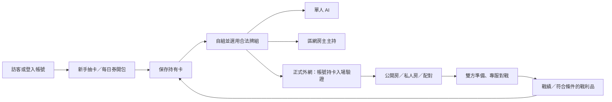

# 🃏 HD-2D 卡牌對戰 — 現行設計與開發進度

> [!abstract] **文件更新與核對說明**
> - **更新日期：2026-10-14，整理版 v2.7。** 依 `/Users/harvey/repo/card-game-demo-4.5--main` 的目前工作樹核對，包含未提交修改；HEAD `b06fa3d2`，`project.godot` 版本字串 `2026.10.14-R8`。
> - **工作樹與已發布要分開看：** 工作樹是 R8；GitHub Release 的 R8 已於 2026-10-14 07:44 UTC 發布，R7／R6 已改回 Draft，R5 的玩家包與伺服器包都已撤下。
> - **本輪修正的錯誤：** 舊版寫「PvP 最後十六秒倒數」，實際是十五秒（`src/net/pvp_turn_clock.gd:4` `WARNING_SECONDS := 15`）；協定版本十六是另一回事，兩者被混在一起。
> - **本輪新增現況：** 玩家包隔離與 PCK 加密、掛名收尾與遊戲內著作權聲明、更新檢查、線上大廳與雲端 SQL 的實測證據、卡片與主選單 UI 盤點。
> - **舊待辦已改正：** 自組牌、抽卡、帳號收藏、結界、派系換位、死靈與史萊姆卡、圖解教學都已有實作，不再標成未做。
> - **真正缺少：** 特殊召喚、完整反制堆疊、通用移動／退場、天梯與交易、口袋／探索模式；另外有正式服務與真人流程待驗收。
> - **保存範圍：** 上半部是現況，下半部「原 v2.0 完整企劃案」原文保留；檔名與 `notion-id` 不變。本輪另完成隨機先手、後援與空手補牌，執行背景測試；不開遊戲視窗、截圖或遠端部署。

> [!tip] **章節快速導航**
> - [[#一、閱讀方式與狀態定義|一、狀態定義]]
> - [[#二、目前遊戲定位|二、遊戲定位]]
> - [[#三、已實作進度表（優先閱讀）|三、已實作進度]]
> - [[#四、現行規則摘要|四、現行規則摘要]]
> - [[#五、尚未完成與原企劃差異|五、未完成與原案差異]]
> - [[#六、可玩性與對局深度診斷（對齊商業 CCG 差距）|六、可玩性診斷]]
> - [[#七、本次核對與後續交接|七、核對與交接]]
> - [[#八、原 v2.0 完整企劃案（設計保留區）|八、原設計保留區]]

---

## 一、閱讀方式與狀態定義

- **① 結論／根本原因：** 找到程式、完成部署、玩家實際驗收是三件不同的事，本文件分開記錄。
- **② 怎麼解：** 每項狀態附目前來源；原設計與現況不一致時列為差異，不直接改回原案。

| 狀態 | 意義 |
| --- | --- |
| **已實作** | 已找到可用程式、資源及入口；不代表本次已重新試玩 |
| **部分實作** | 已完成指定卡牌或部分流程，尚未涵蓋原案全部要求 |
| **未實作** | 在本次核對範圍未找到完整功能及入口 |
| **待驗收** | 已有程式或歷史測試，但缺指定版本的實機／正式服務／真人證據 |
| **待決策／延後** | 原案與現行規則不同，或已有延後決議；不自動列為必須補做 |
| **歷史已部署** | 有指定版本的部署紀錄；不代表目前工作樹的新版也已上線 |

- **③ 為什麼這樣解：** repo 的部分總覽仍保留舊版數字；以現行規格、實際程式／資源及有版本的驗收文件交叉核對，避免沿用過時待辦。
- **④ 舉例：** R4 公開大廳已有正式驗證；目前工作樹協定是十六，不能因此寫成「協定十六已部署」。

## 二、目前遊戲定位

- **① 結論／根本原因：** 本作已是具備收藏、自組牌及多人房間的《暮色秘典》原型，已超過隨機發牌的對戰展示階段。
- **② 怎麼解：** 保留「站位、魔力回收、從者／法術與反制」核心；玩家用持有卡自組牌，AI 使用內部主題預組。
- **③ 為什麼這樣解：** 四路前後排、條件連動與派系效果已能構成準備和兌現；剩餘工作應分成玩法擴充、正式服務驗收與品質調整，不再把已有功能重做一次。
- **④ 舉例：** 玩家可先抽新手卡，保存並選用合法牌組，挑戰 AI；外網正式入場另由帳號服務驗證雲端持卡。引擎為 Godot 4.7／Forward+。

## 三、已實作進度表（優先閱讀）

- **① 結論／根本原因：** 核心對局、卡池連動、收藏組牌與多人基礎已落地；商業品質與正式真人流程仍分別待驗。
- **② 怎麼解：** 以下列出本次找到的入口，不將歷史測試數字當作本次重新執行結果。

| 系統 | 狀態 | 目前具體內容 | 程式／文件依據（repo 相對路徑） |
| --- | --- | --- | --- |
| 對局與資源 | 已實作 | 玩家生命、勝負、四路前後排、魔力成長、暫時回魔與冷卻 | `src/battle_manager/battle_manager.gd`、`board_layout.gd`、`src/hero/hero.gd` |
| 攻擊與行動 | 已實作 | 可跨路指定前排；活前排保護同欄後排；普攻擇一／獨立攻擊、反擊與召喚暈眩 | `action_target_block_reason()`、`skill_block_reason()`、`tests/combat_target_test.gd` |
| 條件連動 | 已實作 | 本回合施法、目標狀態、我方場上人數、墓地門檻；副本加值不污染共用卡片 | `src/card/skill_data.gd`、`BattleManager.resolved_skill()` |
| 靈裝與額外技能 | 已實作 | 裝備加成、新蓋舊、宿主離場；破界杖授予額外技能且有獨立次數 | `attach_equip()`、`src/battle_manager/equipment_skills.gd` |
| 瞬咒／伏印 | 部分實作 | 事件式反制、私密揭示選擇、公開觸發演出、宿主規則；沒有通用任意長度回應鏈 | `quick_candidate()`、`trigger_target_ward()`、`src/net/online_battle.gd` |
| 死靈流派 | 已實作 | 二十種新增卡、墓地／放逐、復活、反向治療、骨盾、亡語及法術獻祭 | `src/battle_manager/necromancy_effects.gd`、`docs/necromancy_cards_acceptance.md` |
| 混沌骰術 | 已實作／真人待驗 | 擲骰、爆擊、改骰／重擲、衍生骰靈；雙方可見演出與主持端判定 | `dice_effects.gd`、`dice_presentation.gd`、`docs/dice_presentation_acceptance.md` |
| 法師七派 | 已實作／持續平衡 | 種族結界、鍊金配方、召還、預言／排序、惑控洞悉、鏡像／替身、變形 | `mage_core_effects.gd`、`mage_support_effects.gd`、`docs/mage_factions.md` |
| 六族與結界 | 已實作 | 六種結界、部族條件、進場／交戰收益、限定換位及破界 | `tribal_effects.gd`、`data/cards/domain_*.tres`、`docs/tribal_factions.md` |
| 單人 AI | 已實作／策略待打磨 | 合法出牌、技能、靈裝、伏印、反制與回魔；從內部預組取牌 | `src/ai/enemy_ai.gd`、`src/card/deck.gd` |
| 收藏與自組 | 已實作 | 持有量、搜尋篩選、費用曲線、草稿、刪除、選用與合法性驗證；玩家沒有免費預組備援 | `src/collection/deck_library.gd`、`src/ui/deck_builder_panel.gd` |
| 抽卡與每日券 | 已實作 | 零卡新手額度、批次抽卡／開包、稀有度權重、滿三張排除、每日券累積與結果保存 | `player_collection.gd`、`pack_definition.gd`、`src/ui/card_pack_panel.gd` |
| 訪客與帳號收藏 | 已實作／完整流程待驗 | 訪客本機練習；登入帳號走 HTTPS RPC／SQL 權威、持卡入場驗證，失敗不回退成本機發卡 | `src/account/`、`src/collection/collection_service.gd`、`deploy/account/README.md` |
| 多人房間 | 已實作／版本待更新 | 公開列表、私人房碼、準備、在線人數、快速配對及區網；正式外網由專服驗證 | `src/net/net_client.gd`、`src/server/game_server.gd`、`match_room.gd` |
| 先後手／後援／空手補牌 | 已實作／平衡待驗 | 隨機先手、後手一次性暫時魔力；自然抽牌空手二張、否則一張；AI 與區網／專服共用規則 | `BattleManager.use_reinforcement()`、`end_turn()`、`docs/opening-balance-20261013.md` |
| PvP 思考時間 | 已實作 | 主持端計時、最後倒數與逾時換邊；PvE 不限時 | `src/net/pvp_turn_clock.gd`、`src/battle_ui/pvp_turn_clock_widget.gd` |
| 戰績與真人選牌 | 已實作／正式流程待驗 | 正式勝敗記錄與重送；符合規則的真人勝者選敗者起始牌組卡，資料庫轉移持卡；區網有本機收據流程 | `match_record_service.gd`、`match_reward_store.gd`、`src/account/match_spoils_client.gd` |
| 新手教學與查閱 | 已實作 | 遊戲內圖解、詳細規則、卡圖鑑／我的收藏、召喚物與關鍵字說明、墓地與戰鬥紀錄 | `src/ui/player_guide_content.gd`、`effect_glossary.gd`、`src/battle_ui/battle_archive.gd` |
| 載入、設定與音畫 | 已實作／品質待驗 | 分階段載入、繁中／英文、畫質／無障礙、配樂／環境聲、命中／格擋／狀態／死亡回饋 | `src/loading/`、`src/settings/`、`src/audio/`、`src/fx/` |
| 場景與美術 | 已實作／尚未完成風格驗收 | 森林、洞窟、冰原及城鎮，地貌／光影／環境粒子；卡圖逐張審查仍有待重繪、校準與缺圖 | `src/environment/`、`docs/art/card-art-audit-20261012/README.md` |
| 玩家包隔離 | 已實作／R8 待驗 | `exclude_filter` 排除 `src/server/*`、`deploy/*`、`tests/*`、`*.pem`／`*.key` 及三組未確認授權素材。R7 成品實測這些路徑皆為 0 命中，`public/SHA256SUMS` 與 GitHub 附件 digest 一致 | `export_presets.cfg`、`tests/exported_release_test.gd`、各版 `*-packed-validation.json` |
| 玩家包加密 | 已實作／R8 待驗 | `encrypt_pck=true`，用自編譯的加密範本（`build/export-templates/4.7.2.encrypted/`），對 311 個卡牌／設定 `.res` 設 include filter，含 `account_service.tres` | `export_presets.cfg`、commit `318eec70` |
| 掛名與著作權 | 已實作 | 未確認授權素材改為整組不出貨（非補作者名），遊戲內新增「著作權聲明」區；`credits_text_test` 100 檢查 0 失敗 | `CREDITS.md`、`assets/licenses/third-party-provenance-20261013.md`、`src/ui/credits_panel.gd` |
| 更新檢查 | 已實作／有版面瑕疵 | 主選單右下按鈕觸發版本檢查，有更新時開全螢幕提示 | `src/release/update_checker.gd`、`src/ui/update_notice.gd`、`main_menu.gd:678` |

- **③ 為什麼這樣解：** 「有六種結界」不等於原案的全場共用領域完全相同；「有種族換位卡」也不等於所有從者都能移動。
- **④ 舉例：** 月汐引流者能將另一名潮民移到同路另一排空格，且保留已用行動；沒有替其他所有卡新增自由換位按鈕。

## 四、現行規則摘要

### 1. 對局、站位與行動

- **① 結論／根本原因：** 現行是四路、自然十魔力與卡面決定的行動選擇，舊版五路／七魔力／人人雙動敘述已過時。
- **② 怎麼解：** 以現行 `BoardLayout`、`BattleManager` 與卡面核對下表。

| 項目 | 現行實作 |
| --- | --- |
| 玩家生命與勝負 | 起始 20；對手生命歸零分勝負 |
| 棋盤 | 每方四路 × 前後兩排，共八格；全場十六格 |
| 普通攻擊目標 | 可跨路指定敵方前排；敵方後排同欄有活前排時受保護。嘲諷等明文限制另算 |
| 直擊英雄 | 檢查攻擊者同路敵方前排及嘲諷；飛行依明文特例，不能穿透後排保護 |
| 自然魔力 | 起始上限零；自己回合開始加一並回滿，上限十 |
| 回收手牌 | 得到 `floor(Cost / 2)` 暫時魔力；可超過自然上限，自己下回合清除；用後下一自己回合不能再回收 |
| 起手與先後手 | 主持端隨機決定先手，與房主及網路座位分開；雙方起手五張，先手開局不另抽，後手首次行動前照常自然抽一張 |
| 後手後援 | 每局一次，後手可在自己的回合按「後援」獲得一點暫時魔力；可保留稍後使用，與回收併用、不算卡牌或施法，下次自己回合開始清除 |
| 自然抽牌／手牌 | 回合開始效果結算後、自然抽牌前空手就抽兩張，否則一張；法術／戰吼照卡面。手牌上限八，溢出入墓；牌庫不足只抽剩餘張數，無疲勞傷害 |
| 普攻／技能 | 普攻每回合一次；強化攻擊及標示共同行動的支援與普攻擇一，獨立攻擊保留額外攻擊；一般支援可另用 |
| 召喚暈眩 | 普攻與兩種攻擊型技能當回合不能用，衝鋒例外；非攻擊技能可用 |
| 戰鬥 | 普攻／強化攻擊打從者會受到反擊；獨立攻擊不受反擊；打英雄不受反擊 |
| 靈裝／伏印 | 新裝替換舊裝並收回加成；伏印不佔槽，多數埋於己方宿主，屍變伏印另有敵方宿主規則 |
| 結界 | 每方最多一張，新結界替換自己的舊結界；不是全場共用一張 |
| 思考時間 | PvE 不限時；PvP 每回合一百秒，最後十五秒倒數（`pvp_turn_clock.gd` `WARNING_SECONDS := 15`）；逾時後完成當前結算再換邊，禁止新行動 |
| 回合階段 | 有回合開始／抽牌／結束處理與反制窗口；沒有玩家獨立切換 Main／Attack 階段的完整控制介面 |

- **③ 為什麼這樣解：** 同時分清一般規則與卡牌例外，才不會把角色技能、沙盒或派系操作當成所有牌共有能力。
- **④ 舉例：** 劍士選免費三傷普攻，或一魔力連擊兩次各二傷；牧師治療後仍可普攻。自然魔力十時，十一費卡至少回收一張二費卡即可支付。

### 2. 卡池與牌組盤點

- **① 結論／根本原因：** 現行正式卡池已擴充，舊文件的基礎卡數不能再代表完整內容。
- **② 怎麼解：** 按 `CardData.card_type` 與 `is_token` 統計，不把衍生物當作可抽正式卡；本次已直接核對資源分類與圖鑑 ID 集合。

| 卡型 | 正式卡種 | 衍生物／形態 |
| --- | ---: | ---: |
| 從者 MINION | 141 | 10 |
| 靈裝 EQUIP | 9 | 0 |
| 秘術 ARCANA | 67 | 11 |
| 瞬咒 QUICK | 8 | 0 |
| 伏印 WARD | 13 | 0 |
| 結界 DOMAIN | 6 | 0 |
| **合計** | **244** | **21** |

| 配套資料 | 現況 |
| --- | --- |
| AI 參考預組 | 十九套，每套二十種、各三張；不代表玩家免費持有 |
| 卡包定義 | 十七份，含新手全卡池與主題包 |
| 玩家牌組 | 恰六十張、同 ID 最多三張、不超過持有量；未完成可以存草稿，不能選用進場 |
| 稀有度 | 普通／稀有／史詩／傳說；現行金屬卡框與原案銀金紫配色不同 |

- **③ 為什麼這樣解：** 卡種數、持有張數及預組張數不同；部族標籤也不等同英雄職業選擇。
- **④ 舉例：** 鍊金材料與藥劑有卡片資源及圖鑑內容，但屬衍生牌，由卡牌效果產生，不直接混入一般抽池。完整卡表見[可搜尋卡牌總表](../../repo/card-game-demo-4.5--main/docs/card-catalog.html)。

### 3. 收藏到對局的現行流程

- **① 結論／根本原因：** 已有抽卡、保存與入場驗證流程；目前原始碼允許新手未抽完就用合法持有牌組進場。
- **② 怎麼解：** 訪客本機與登入帳號分開處理；R5 帳號入場鬆綁另需第六份 SQL 遷移及同版服務。

| 流程 | 現行規則與限制 |
| --- | --- |
| 新手 | 新訪客／新政策帳號零卡起始，贈送一百五十張單卡抽取額度；批次可選一／十／五十／一百張，剩額可稍後領取 |
| 提早組牌 | 合法持有六十張即可選用進場，不再必須抽完全部新手額度；正式雲端已驗（`build/release-20261013-R5/hosted-schema-verification.json` 的 `starter_draw_gate_removed: true`）|
| 每日 | 每個登入日一張包券，台北日期換日，未花券累積；未登入日不補發 |
| 一般包 | 每包五張、消耗一券；批次可選一／十／五十／一百包；新手剩額歸零才開放一般包 |
| 基礎抽取權重 | 普通／稀有／史詩／傳說為 61%／30%／7.2%／1.8%；同級可抽卡等機率，持有三張者排除，級別抽空時重算權重；沒有保底 |
| 帳號保存 | 登入帳號的持卡、額度、包券、收據及正式入場由 SQL 決定；訪客收藏與本機牌組存檔不能作為雲端持有權證明 |
| 戰利品 | 已有真人勝者選牌與轉移；不是原企劃暗巷的雙方事先押卡。斷線可記錄結果，但不等同正常擊敗的奪卡條件 |

- **③ 為什麼這樣解：** 舊 R2 的本機每日免費包及 R3／R4「抽完才進場」是版本歷史，不再直接套用目前工作樹。
- **④ 舉例：** 玩家仍有五十張新手額度，但已選用合法自組牌，現行程式應允許對戰；仍不能提前花每日券開一般包。雲端是否符合此規則，要另外驗證第六份 SQL 已部署。

## 五、尚未完成與原企劃差異

### A. 原企劃仍未完成的功能

- **① 結論／根本原因：** 原案真正還缺的是特殊召喚、通用回應與探索／競技／交易層，不能把現有的類似卡牌效果視為全部完成。
- **② 怎麼解：** 下表保留未完成項目與界線；是否繼續做屬後續決策，本次不新增遊戲機制。

| 功能 | 狀態 | 仍缺什麼／不能混淆的既有功能 |
| --- | --- | --- |
| 獻祭召喚 | 未實作 | 沒有完整 `Sacrifice` 數值、候選資格與補差額召喚入口。禁忌獻儀的犧牲友軍抽牌不等同獻祭召喚 |
| 捨棄召喚 | 未實作 | 沒有依單卡指定捨棄種類、減費／免魔力的召喚流程；棄牌回魔與棄抽已實作，需分開追蹤 |
| 任意長度 Stack | 未實作 | 現有事件反制及選擇流程，尚無雙方反覆加效果、讓過優先權、後進先出結算的通用堆疊 |
| 嚴格五階段控制 | 部分實作／待決策 | 開始、抽牌、結束與觸發已有；Main／Attack 仍可在同回合操作，沒有完整玩家切換階段機制 |
| 通用攻擊範圍／換位／突進 | 部分實作 | 已有保護規則及派系移位，但無通用 `attack_range` 或所有對應關鍵字共用的移動指令；「突進」標記不等於移動已開放 |
| 任意從者主動退場／回收卡槽 | 未完整實作 | 已有召還與特定法術犧牲；沒有所有從者共用的退場按鈕。是否需要，應按實際對局決定 |
| 後手補償 | 已實作／平衡待驗 | 主持端隨機先手，後手每局一次「後援」增加一點暫時魔力；沒有額外塞卡。雙方起手五張，後手首次行動前自然抽一；勝率仍需同版真人量測 |
| 獨立英雄技能／職業限制 | 部分設計／延後 | 七派是卡牌連動，沒有完整英雄選職業與職業卡限制。死靈英雄主動技能、專用盾衛 token、死亡騎士仍未落地，見死靈設計決議 |
| 正式經濟擴充 | 部分實作 | 已有包券、權重及持卡上限；缺保底、分解／合成、重複卡轉換、付費貨幣／商品等；不是「完全沒有抽卡經濟」 |
| 共通／獨特口袋 | 未實作 | 收藏不是原案具有獨立限制與交換規則的兩種口袋 |
| 非戰鬥咒語卡 | 未實作 | 「同行／磁力／盜竊／黏手指」的探索傳送、搶奪與口袋交換沒有完整入口；戰鬥召還／借咒不能替代 |
| 天梯／積分／排行榜 | 未實作 | 已有可信勝敗記錄，但沒有段位、積分、排名配對、賽季或排行榜 |
| 獨立不奪卡自由對戰 | 未找到完整模式開關 | 普通房間已能對戰；尚未找到原案「不賭卡」獨立模式與獎勵規則，不能用公開房名稱代替 |
| 拍賣／玩家交易／自由賭場 | 未實作 | 沒有入場持卡門檻、交易撮合、事先押注與防重複轉移的完整模式；現有勝者選牌不是拍賣或雙方押注 |
| 無名者暗巷 | 未實作 | 匿名斗篷、多人探索地圖、迷霧、隨機迷宮、碰撞決鬥、出口、衛兵、寶箱陷阱及鏡像 NPC 模式均未落地 |
| 大型世界觀／戰役 | 部分設計 | 六族與法師已有原創設定和規則；尚非可探索世界、完整劇情或角色職業成長流程 |

- **③ 為什麼這樣解：** 不同機制需要自己的成本、入口與結算；表面同名不能當作完成證據。
- **④ 舉例：** 霧幕替身是伏印，讓鏡像承受攻擊；它不是暗巷中模仿玩家牌組、具掉落經濟的鏡像 NPC。

### B. 已有功能，但仍缺驗收或品質收尾

- **① 結論／根本原因：** 現在最接近可交付的缺口是新版服務整合、真人完整流程、平衡與美術一致性，並非再加一批基礎功能。
- **② 怎麼解：** 將可查證的歷史部署與本機新版分開，不自行宣稱正式環境已追上工作樹。

| 工作 | 目前證據 | 還需完成 |
| --- | --- | --- |
| 同版客戶端／專服／SQL | 工作樹與正式大廳都是協定十六：`public-lobby-probe.json`（2026-10-13）顯示三個公開 ENet 用戶端在 `34.81.8.238:8910` 收到 welcome 與 presence，PASS；`hosted-schema-verification.json` 以唯讀 `pg_proc` 查詢實際 hosted Supabase，`security_definer` 與 `empty_search_path` 皆為真 | R8 成品的同版雙端驗收；本機沒有 R8 的 exe／pck，封裝稽核 **待驗收** |
| 真實帳號流程 | R3-S150 有 Supabase 安裝及 OTP 郵件投遞紀錄，R4 公開大廳探針通過 | 玩家輸入驗證碼登入、雲端抽卡、組牌、兩個正式帳號完整對局、戰績及戰利品後雙方收藏同步 |
| 跨裝置與訪客綁定 | 帳號收藏 RPC 已有；訪客本機與雲端分開 | 實際跨裝置登入一致性待驗；訪客進度合併／綁定未完成，不能直接上傳本機卡量 |
| 斷線恢復與伺服器營運 | 已有房間回收及戰績／戰利品待送保存 | 同一局斷線重連未做；維護模式、容量壓測及長期可用性尚未完成 |
| 對局平衡與 AI | 已有共同行動與流派條件、AI 合法操作 | 收集先後手、對局長度、卡牌使用與派系對戰資料，評估套路強度和 AI 出牌順序；不填虛構勝率 |
| HD-2D 精美程度 | 三戰場與現代特效已有；十月十三日逐張卡圖審查仍列待重繪、校準與缺圖 | 完成風格修訂及集中驗收；不能宣稱達到《歧路旅人》九成或商業品質 |
| 音訊與操作品質 | 配樂／環境聲／戰鬥回饋、滑鼠 UI、雙語與無障礙設定已有 | 真人聽感、音量與光強接受；控制器／觸控未完整實作；資源釋放與長時間執行仍需按版本複驗 |
| 資訊安全 | `tcg_private` 全表開 RLS，讀取政策為 `auth.uid() = account_id`；`tcg_open_packs` 等 SECURITY DEFINER function 的帳號取自 `auth.uid()` 而非參數，並設 `search_path = ''`；client 只帶 publishable key 與服務網址（設計上公開） | R5 期間 `TwilightCodex-Server-*.tar.gz` 曾公開掛在 Release（已移除，見 `removed-server-attachments.json`），可查當時下載次數；R8 成品的憑證掃描待做 |

- **③ 為什麼這樣解：** 「已部署」只能描述有版本證據的服務；資料庫安裝成功也不代表已完成玩家實際登入及轉移卡片流程。
- **④ 舉例：** 正式大廳可顯示房間，不代表舊 SQL 已允許新手未抽完的帳號進場；只換客戶端不能解決服務版本差異。

### C. 已改規則，不再當作未完工

- **① 結論／根本原因：** 原案與實裝不同不必然是缺功能，先保留差異與決策依據。
- **② 怎麼解：** 以下使用現行實裝，不自動按原企劃改回。

| 原案／舊文件 | 現行實作 |
| --- | --- |
| 五路 | 四路前後排；已是明確改版 |
| 舊整理版自然魔力七 | 已改十，與原 v2.0 自然上限一致 |
| 所有從者普攻＋技能兩動 | 依卡面分共同行動、獨立攻擊及支援；另有裝備技能次數 |
| 領域全場只存在一張 | 每方一張種族結界；共有六種正式卡 |
| 普通銀／稀有金／史詩紫 | 現行四級稀有度與金屬框／光效，需保留設計差異，不稱原色碼已照搬 |
| 現在不做抽卡／玩家用隨機牌組 | 已有新手、每日券、權重與收藏自組；隨機全卡池混編不再是玩家正式入口 |

- **③ 為什麼這樣解：** 把規則變更錯列為未做，會要求工程恢復已淘汰的流程。
- **④ 舉例：** 「補領域卡」不再是待辦；若要改成雙方共用全場一張領域，應視為新的規則決策。

## 六、可玩性與對局深度診斷（對齊商業 CCG 差距）

- **① 結論／根本原因：** 舊診斷中的「完全沒有 combo、抽濾與自組牌」已失效；現在需要驗證連動是否值得使用、能否被反制，以及玩家是否讀得懂。
- **② 怎麼解：** 改用現有卡組與操作找問題，不從未量測數據推導勝率或畫面品質。

| 舊診斷 | 現在應怎麼看 | 建議下一步（不構成新增實作授權） |
| --- | --- | --- |
| 隨機大雜燴，沒有套路 | 已有玩家自組、AI 主題預組、四種通用條件與多套派系連動 | 檢查每派準備牌、收益牌、補牌與終結方式是否完整；避免少數無條件高傷蓋過全部連動 |
| 沒有過牌，第五回合必然枯竭 | 已有抽牌／窺視／棄抽／排序、條件戰吼與派系補給；新增空手自然抽兩張 | 量測手牌耗盡時點與可用操作，再調補牌；不沿用未驗的「必然」結論 |
| 前排卡死，不能移位 | 已有召還、潮民換排、風暴城調度、特定犧牲與變形 | 先看實戰是否仍卡死，才決定加入所有從者通用的退場或移動 |
| 前期人人雙攻 | 已重配低費共同行動，保留少數高費／稀有獨立攻擊及低傷例外 | 特別檢查固定傷、連擊、反擊與額外裝備技能加總後的每回合收益 |
| 後手必定大幅劣勢 | 已加入隨機先手與一次性後援，尚無版本化先後手勝率 | 量測新規則下雙方勝率、後援使用回合及收益，再調整補償量 |
| 缺乏翻盤效果 | 已有復活、群體清場／治療、骰術爆擊、鍊金與結界收益 | 評估準備成本、對手能否打斷；不要只提高數值或再給免費行動 |
| 敵方後排縮小固定比例／已達商業品質 | 已調相機、數值圖示、預覽與場景；舊百分比無本次量測證據 | 以真實可讀性與逐張畫法審查驗證，不寫未量測的縮小比例或相似百分比 |
| （本輪新增）讀一張卡的路徑 | 查完整卡文有三種手勢：手牌右鍵、敵方場上左鍵、我方場上開指令選單；只在教學第八章講過，對局畫面無提示 | 統一手勢並在 HUD 常駐提示。不要直接改回 hover 自動展開——當初改成右鍵是為了不擋第四路（`card_manager.gd:278`），要解的是面板位置 |
| （本輪新增）卡面資訊量 | 卡面預算 4 行 × 11 字；依 `_fit_card_text` 演算法**估算** 232 張中 105 張（45%）會被截成「…」。靜止手牌只露出費用與半個卡名，攻血／卡型／卡文都看不到 | 手牌靜止高度上移讓卡名完整露出；卡面文字區加寬或縮短卡文 |
| （本輪新增）無障礙 | 150% UI 不會放大卡面文字：`src/card/card.gd` 完全沒有引用 `ui_scale`，HUD、英雄、教學、牌庫徽章都有 | 卡面 Label3D 的 `SKILL_TEXT_FONT_SIZE` 跟著 `ui_scale` 調 |
| （本輪新增）操作步數 | 普攻需三次點擊（點從者 → 選「攻擊」 → 點目標），上桌後拖曳是明確關閉的；爐石／闇影詩章是一次拖曳 | 可選：加拖曳攻擊當快捷、選單保留給技能。屬刻意設計（歧路旅人式先選人再選招），改動會牽動 IDLE／TARGETING 狀態機與右鍵取消 |
| （本輪新增）主選單 | 右下「檢查更新」按鈕寬 200px／字級 15，失敗字串「暫時無法檢查更新，可稍後重試。」約 210px，顯示被切成「暫時無法檢查」；`update_unavailable` 是離線必經路徑 | 按鈕只放「檢查更新」，結果改用下方提示或 tooltip |

- **③ 為什麼這樣解：** 功能數量不等於對局深度；調整應建立在同版本玩家實測，避免用新增系統掩蓋現有卡組的不合理收益。
- **④ 舉例：** 龍族先讓目標灼燒，再用燼冠王兌現加傷與橫掃；應觀察對手能否移除已灼燒目標、前期能否撐住及付費是否值得，而不是只看有沒有「龍族」名稱。

## 七、本次核對與後續交接

- **① 結論／根本原因：** 本輪在靜態盤點後完成隨機先手、後手後援與空手自然抽兩張；背景驗證與正式服務驗收分開記錄。
- **② 怎麼解：** 保留原設計，更新現況、分類與未完成清單；用以下來源追查，後續完成一項就更新對應狀態。

| 核對 | 本次結果與限制 |
| --- | --- |
| 程式與卡池 | 已讀對局／目標／牌組／收藏／卡包／帳號／房間／計時／派系相關入口；直接統計 CardData 分類並核對圖鑑 ID 集合 |
| 卡池分類 | 正式與衍生物分開；不再沿用基礎卡池統計 |
| 部署 | 讀取 R3-S150／R4 歷史紀錄及 R5 SQL 要求；未查遠端即時狀態、未更新 VM／資料庫／下載包 |
| 測試 | 本輪執行開局／補牌、AI／按鈕、權威結算、PvP 時鐘及雙進程 LAN 背景測試；實際結果與退出清理警告見 repo `docs/opening-balance-20261013.md`。畫面、公網及新版發行包 **NOT RUN** |
| 文件與美術 | 同步現行規格、雙語教學及部署版本說明；不開新視窗或截圖。其他美術修改分開，未重新打包成品 |
| 保留區 | 原 v2.0 設計段落保留原文，不刪除未做功能或把延伸提案當作已授權 |
| 發布狀態 | 工作樹 `2026.10.14-R8`（HEAD `b06fa3d2`）；GitHub Release R8 已發布（2026-10-14 07:44 UTC），R7／R6 已改 Draft，R5 玩家包與伺服器包撤下 |
| 成品驗證 | R7 的 Windows／macOS 成品實測排除項目皆 0 命中，雜湊與 Release 附件一致；**R8 成品本機沒有，未驗** |
| 待提交 | `data/cards/` 有 12 張卡的文字清理尚未提交；`docs/card-catalog.html` 仍是舊卡文（五張對不上），與未提交的 `tools/update_card_catalog.py` 同屬一包 |
| 方法限制 | 用 `strings` 掃成品只對**檔案路徑**與 `.tres` 內容有效；GDScript 是 binary token 加壓縮，掃不到內容。卡面與 hover 的實際觀感 **NOT RUN**，擷圖來源是 1280×720／100% UI／離線訪客的 fixture |

- **③ 為什麼這樣解：** `docs/demo_readiness.md`、README 的個別表格及舊部署頁仍有過時卡數／領域／協定／抽卡描述，本文件不能只抄一份總覽就宣稱現況一致。
- **④ 舉例：** 先查 `src/net/lobby_protocol.gd` 的十六版，再查同版發行證據；找不到，就保留「新版待發布／待驗收」，而不是套用 R4 已發布結論。

> 連結指向本機 repo；搬移筆記或匯入 Notion 後可能需要重新設定。這次更新的是本機 Obsidian Markdown，不代表 Notion 雲端頁面已同步。

- [現行玩法規格](../../repo/card-game-demo-4.5--main/README.md)
- [可搜尋卡牌總表](../../repo/card-game-demo-4.5--main/docs/card-catalog.html)
- [對局結算與實際規則](../../repo/card-game-demo-4.5--main/src/battle_manager/battle_manager.gd)
- [棋盤配置](../../repo/card-game-demo-4.5--main/src/battle_manager/board_layout.gd)
- [連線協定](../../repo/card-game-demo-4.5--main/src/net/lobby_protocol.gd)
- [法師七派](../../repo/card-game-demo-4.5--main/docs/mage_factions.md)
- [六族結界](../../repo/card-game-demo-4.5--main/docs/tribal_factions.md)
- [死靈卡與英雄技能延後決議](../../repo/card-game-demo-4.5--main/docs/necromancy_archetype.md)
- [R5 帳號收藏與第六份遷移](../../repo/card-game-demo-4.5--main/deploy/account/README.md)
- [專服部署與版本要求](../../repo/card-game-demo-4.5--main/deploy/server/README.md)
- [R4 歷史正式部署及公開房驗收](../../repo/card-game-demo-4.5--main/docs/multiplayer-r4-20261011.md)
- [R3-S150 帳號、寄信與成品紀錄](../../repo/card-game-demo-4.5--main/docs/primary-sync-20261011.md)
- [目前卡圖逐張審查](../../repo/card-game-demo-4.5--main/docs/art/card-art-audit-20261012/README.md)
- [Demo 現況總覽（部分敘述待同步，需交叉核對）](../../repo/card-game-demo-4.5--main/docs/demo_readiness.md)

---

## 八、原 v2.0 完整企劃案（設計保留區）

> 以下保留原始設計細節，供追溯與後續取捨；包含已改規則、未實作功能及美術目標。**目前進度與規則以上方表格為準**，不是以下每一條都已落地。原稿更新日期為 2026-04-21。

## 1. 核心玩法規則 (Core Mechanics)

### 1.1 基礎規則

- **勝利條件**：將對手主堡（玩家）生命值從 **20** 降至 **0**。
- **玩家生命值**：20 點。
- **戰場佈局**：雙方各 **5** 條並排格子（**路線 / Lane**）。
	- 每條路線可容納：**前排從者**（可被攻擊/阻擋）與其**附著的靈裝 / 伏印**（若有）。
- **攻擊規則**：
	- 若該路線前排**沒有敵方從者阻擋**，則直接攻擊對方玩家（Face）。
	- 若有阻擋，則先對該從者造成傷害。

### 1.2 資源機制（魔力 Mana）

- 遊戲開始時 **魔力上限 = 0**。
- 每位玩家在**自己回合開始時**：
	- **魔力上限 +1**（最高 10）
	- **魔力回滿至上限**
- **未使用的魔力不會累積**到下回合。
- 每回合開始時可以選擇捨棄一張牌,根據他的消耗魔力的數一半(小)回流給這回合的魔力counter(也可以不捨棄)

### 1.3 召喚機制 (Summoning Logic)

- **一般召喚**：支付卡牌右上角標示的 **Cost**（魔力）。
- **獻祭召喚 (Sacrifice Summon)**：
	- **觸發時機**：當現有魔力 < 目標卡牌魔力時，可選定場上一張卡牌進行獻祭以補足差額。
	- **計算公式**：`獻祭單位消耗魔力 + 當前剩餘魔力 = 召喚卡牌魔力`
	- **被獻祭單位的條件（需同時滿足）**：
		1. 本回合尚未承受過攻擊
		2. 本回合尚未進行攻擊
		3. 本回合尚未發動主動效果
		4. 生命值 > 50%（計算：`Math.floor(MaxHP / 2)`）
- **捨棄召喚 (Discard Summon)**：
	- **條件**：需捨棄手牌才能召喚（無視魔力或減少魔力，視單卡設計）。
	- **代價類型**：捨棄任意一張手牌 / 捨棄特定類型（如魔法卡）。
	- 獲得捨棄的卡牌的消耗點數的一半魔力

---

## 2. 回合階段與流程 (Turn Structure)

> 目標：建立清晰的「階段次序」與互動窗口（含 Stack）。可參考 MTG 的回合結構概念，但以本遊戲規則為主。

1. **開始階段（恢復階段）**
	- 魔力上限 +1、魔力回滿
	- 進行清算：解鎖從者、解除持續狀態等
	- 「回合開始時」觸發效果進入堆疊（若使用 Stack）
2. **抽牌階段**
    
	- 抽 1 張牌（牌庫用盡時的規則另行定義）
    
	-（可選）檢查手牌上限並丟棄多餘手牌
    
3. **主要階段 (Main Phase)**
	- 可使用手牌：召喚從者、施放秘術、佈置伏印、附著靈裝、啟動主動能力等
	- 玩家可自行決定進入攻擊階段的時機
4. **攻擊階段**
	- 宣告攻擊者與攻擊目標（路線/前排阻擋規則）
	- 於宣告、傷害計算前後，皆存在反應窗口（瞬咒/伏印觸發等）
5. **結束階段**
	- 回合結束檢查、處理回合末效果
	- 檢查敗亡條件（生命值 ≤ 0 判定勝負）

### 2.1 堆疊系統（Stack）

- 所有「施放的秘術 / 瞬咒」、「伏印觸發效果」、「可回應的能力」會進入堆疊。
- **結算順序：後進先出（LIFO）**：最後加入堆疊的效果最先解決。
- 雙方可在適當窗口互相回應，形成策略深度（預判、誘導、反制）。

---

## 3. 卡牌系統與邏輯 (Card System)

### 3.1 從者卡 (Unit / Followers)

- **定義**：場上實體單位，可攻擊、防禦、承受傷害，可搭載靈裝、被附伏印卡。
- **數值結構**：
	- `Cost`（藍 / 右上）：召喚所需魔力
	- `Sacrifice`（黃 / 左上）：獻祭可提供的魔力值
	- `Atk`（紅 / 左下）：攻擊力
	- `HP`（綠 / 右下）：生命值
- **技能觸發類型**：
	- **進場發動 (On Play)**：打出/召喚成功時立即生效
	- **位置觸發 (Lane Effect)**：依前排/後排、同路線單位等條件生效
	- **主動發動 (Active)**：玩家手動啟動，通常消耗資源
	- **反應觸發 (Reactive)**：如「受到攻擊時 / 受到傷害時 / 受到效果影響時」

### 3.2 靈裝卡 (Armament / Relic)

- **定義**：附著於從者上的裝備/聖物，提供持續加成或特殊能力。
- **基本規則**
	- 使用時需支付魔力，並指定 1 名從者作為宿主
	- 宿主陣亡或效果解除時，靈裝通常離場（除非卡牌另有敘述）
- **常見效果示例**
	- 「靈裝：附著後，此從者攻擊力 +X」
	- 「靈裝：此從者獲得嘲諷（Taunt）」
	- 「靈裝：此從者每次攻擊額外造成 1 點傷害」

### 3.3 魔法/秘術卡 (Spell Cards)

- **一般秘術**：主動消耗魔力施放，進入堆疊後結算，結算後離場。
- ==**反制秘術 (Counter)**：==
	- **觸發條件**：敵方發動秘術/瞬咒後（依卡牌文字）
	- **消耗**：依卡牌設定（同秘術）

### 3.4 瞬咒卡 (Flash / Reaction Spells)

- **定義**：可在對手回合或我方回合施放的反應型法術（類似 Instant）。
- **用途**：反制、打斷、保護、瞬間增益/傷害。
- **結算**：與秘術一致，進堆疊並遵循 LIFO。

### 3.5 伏印卡 (Trap / Sigil)

- **機制**：埋伏於我方某張從者卡牌後底下（Sub-layer），不立即生效。
- **消耗**：通常在埋設時支付（或免費），觸發時不再消耗。
- **觸發條件（示例）**
	- 宿主成為攻擊目標時
	- 宿主受到效果影響時
- **預設**：觸發後銷毀（若要多次觸發，需在卡面文字定義）。

### 3.6 領域卡 (Domain / Field Card)

- **定義**：影響整個戰場環境的持續性卡牌。
- **基本規則**：同時間只存在 1 張；新領域覆蓋舊領域。
- **結算建議**：可設計為「使用後立即生效並常駐」，是否進堆疊視規則統一。

---

## 4. UI/UX 視覺設計規範 (Visual Guidelines)

### 4.1 稀有度通用配色 (Rarity)

根據卡牌邊框或背景光暈區分：

- **普通 (Common)**：銀色系
- **稀有 (Rare)**：金色系
- **史詩 (Epic)**：紫色系

### 4.2 卡片類型主題配色 (Card Type Themes)

#### 魔法卡配色

- 主體背景：紫藍漸層（`#4B0082` → `#1E90FF`）
- 邊框：亮紫色（`#9400D3`）
- 魔力消耗標示：
	- 背景：皇家藍（`#4169E1`）
	- 邊框：深藍（`#000080`）
- 法術類型標籤：暗蘭花紫（`#9932CC`）
- 文字區域：白色文字配深色背景

#### 陷阱卡配色

- 主體背景：深紅漸層（`#800000` → `#FF4500`）
- 邊框：暗紅色（`#8B0000`）
- 觸發條件標籤：深紅色（`#DC143C`）
- 效果類型背景：深紅色（`#B22222`）
- 文字區域：白色文字配深色背景

|   |   |   |   |   |
|---|---|---|---|---|
|**卡牌類型**|**主體背景 (Gradient)**|**邊框色**|**特殊標籤色**|**備註**|
|**魔法卡**|紫藍漸層   `#4B0082` → `#1E90FF`|亮紫色   `#9400D3`|法術標籤：暗蘭花紫   `#9932CC`|魔力消耗標示背景：皇家藍 `#4169E1`   邊框：深藍 `#000080`|
|**反制卡**|同魔法卡|同魔法卡|同魔法卡|視覺樣式繼承魔法卡|
|**陷阱卡**|深紅漸層   `#800000` → `#FF4500`|暗紅色   `#8B0000`|觸發條件：深紅色   `#DC143C`|效果類型背景：深紅色 `#B22222`|

### 4.3 怪物卡 UI 佈局 (Monster Card UI)

|   |   |   |   |   |   |
|---|---|---|---|---|---|
|**區域**|**位置**|**數值意義**|**主色 (Background)**|**邊框色 (Border)**|**文字色**|
|**魔力值**|右上|召喚消耗|深藍色 `#0066CC`|更深藍 `#003366`|白色|
|**獻祭值**|左上|提供魔力|棕黃色 `#8B4513`|深棕色 `#4A2500`|白色|
|**攻擊力**|左下|傷害數值|紅色 `#CC0000`|深紅色 `#660000`|白色|
|**生命值**|右下|存活數值|淡綠色 `#00CC00`|綠色 `#006600`|白色|

### 4.4 場地結界 (Field Environments)

- **森林系**：綠色漸層（`#228B22` → `#90EE90`）
- **火山系**：紅色漸層（`#8B0000` → `#FFD700`）
- **海洋系**：藍色漸層（`#00008B` → `#87CEEB`）
- **永夜系**：紫色漸層（`#191970` → `#9370DB`）

---

## 5. 世界觀 / 背景設定（草案）

### 5.1 種族（示例）

- 人類：治療、支援向
- 精靈：自然魔法、敏捷
- 機械族：科技元素
- 暗影族：黑暗魔法、控制
- 獸族：力量型（秩序/混沌）
- 不死族：復活、持久戰

### 5.2 職業（示例）

- 戰士：近戰、防禦
- 法師：遠程魔法傷害
- 刺客：高爆發
- 射手：持續遠程
- 守護者：保護、控場
- 支持：增益、治療
- 工匠：機械與道具專精

---

## 6. 玩法延伸構想（保留區）

### 6.1 《貪婪之島》致敬機制 (Greed Island Inspired)

一套獨立的「咒語卡 (Spell Card)」系統，用於非戰鬥或戰鬥輔助：

- **同行 (Companion)**：傳送 (Teleport)
- **磁力 (Magnet)**：躍遷 (Warp)
- **盜竊 (Steal)**：通用搶奪
- **格擋 (Block)**：防禦性技能
- **黏手指 (Sticky Fingers)**：交換雙方的「獨特口袋」卡牌

### 6.2 遊戲模式與經濟 (Game Modes & Economy)

- **口袋系統 (Pocket System)**
	- 共通口袋：基礎卡池
	- 獨特口袋：特殊/稀有卡池
	- 稀有度：白 < 藍 < 黃（金）< 紫
- **活動場景**
	- 拍賣會：持有 10 張卡片可進入
	- 自由賭場：持有 30 張卡片可進入
- **對戰模式**
	- 天梯競技場 (Ranked)
	- 自由對戰（不賭上卡牌）

### 6.3 場景提案：無名者暗巷 (The Nameless Alley)（草案）

- **核心規則：強制匿名 (The Masquerade)**
	- 進入時強制裝備「灰色斗篷」
	- ID 隱藏，頭頂顯示「??? / 流浪者」
	- 無法打字/發話，只能使用簡單表情符號
- **地圖結構：動態迷宮 (The Maze)**
	- 俯視角 HD-2D（探索）→ 進戰鬥切回橫向
	- 迷霧 (Fog of War) + 隨機障礙（Roguelite）
	- 分流房間（20–30 人），玩家無法自選房間
- **互動機制：碰撞與決鬥 (Engagement)**
	- 面對面碰撞或互動鍵 → 發起賭卡決鬥
	- 顯示押注稀有度但不顯示卡名
	- 雙方同意後切入對戰介面
- **撤離機制：出口的博弈 (Extraction)**
	- 安全出口：隨時離開結算
	- 貪婪出口：深處，額外獎勵但高風險
- **干擾元素 (Bomberman Style)**
	- 巡邏衛兵（NPC）：碰到即扣入場費並踢出
	- 寶箱與陷阱：提升探索與遭遇率
- **鏡像 NPC（Doppelgänger Bots）**
	- 生成外觀/牌組類似真實玩家的 AI
	- 玩家勝利獲得掉落（Faucet），失敗則資源回收（Sink）

積分機制: