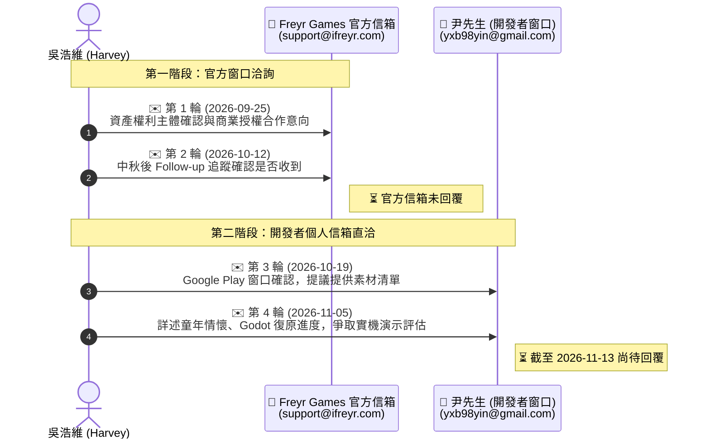
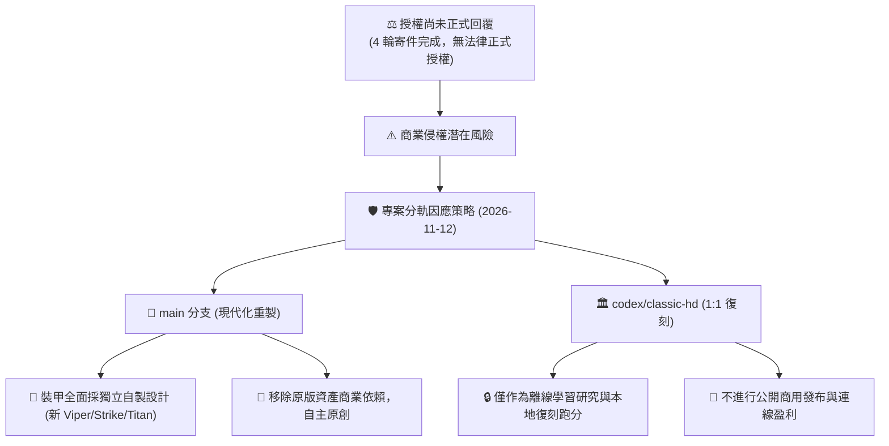

# ⚖️ Star Warfare 原作資產授權洽詢與進度追蹤

> [!abstract] **授權聯絡總覽 (2026-11-13)**
> 紀錄向原開發商 **Freyr Games** 官方與 Google Play 開發者聯絡人 **尹先生 (Yin)** 針對《Star Warfare: Alien Invasion》美術與音效資產正式商業授權之 4 輪洽詢時序。

---

## 🗺️ 洽詢時序與狀態流程圖

---

## 📊 洽詢紀錄明細矩陣

| 輪次 | 發信日期 | 收件對象 | 郵件主旨 | 核心訴求與內容概要 | 目前狀態 |
| :---: | :---: | :--- | :--- | :--- | :---: |
| **01** | `2026-09-25` 12:21:40 | `support@ifreyr.com` (Freyr Games 團隊) | 《Star Warfare: Alien Invasion》遊戲資產權利與授權合作詢問 | • 確認原資產著作權主體與授權權限 • 詢問是否考慮授權獨立開發者修改用於新商業遊戲 • 附 GitHub 開發背景 | 🟡 無回覆 |
| **02** | `2026-10-12` 10:00:00 | `support@ifreyr.com` (Freyr Games 團隊) | 《Star Warfare: Alien Invasion》游戏资产权利与授权合作询问 | • 跟進確認 9/25 信件是否送達 • 請求轉交負責窗口或告知合作意向 | 🟡 無回覆 |
| **03** | `2026-10-19` 10:00:00 | `yxb98yin@gmail.com` (尹先生 / Google Play) | 《Star Warfare: Alien Invasion》资产授权咨询及联系窗口确认 | • 透過 GP 開發者資訊直洽，確認是否為權利窗口 • 表明願整理專案介紹與素材清單評估 | 🟡 無回覆 |
| **04** | `2026-11-05` 10:00:00 | `yxb98yin@gmail.com` (尹先生) | Re: 《Star Warfare: Alien Invasion》资产授权咨询及联系窗口确认 | • 表明童年情感投入與尊重原作心血 • 說明 Godot 離線復原成果，爭取實機演示 • 商業化形式與範圍願完全尊重貴方安排 | 🟡 尚待回覆 |

---

## 🛡️ 風險對沖與開發策略連動

