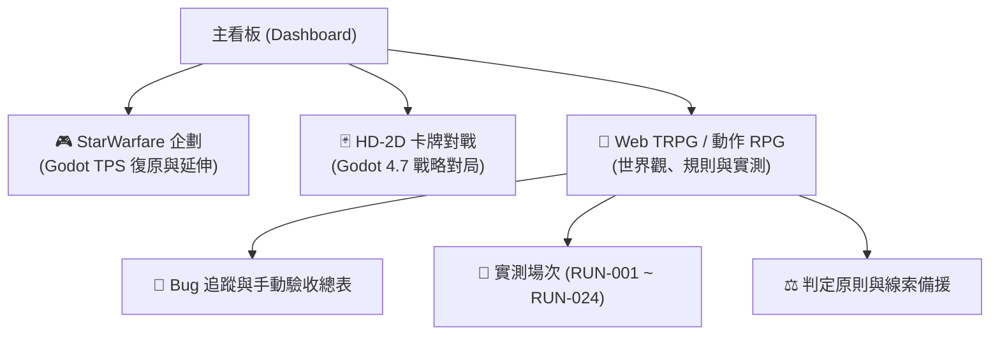

# 🎮 遊戲企劃與開發筆記總覽 (Vault Dashboard)

> [!abstract] **工作區導航說明**
> 本庫收錄目前進行中的三個核心專案：**Star Warfare 射擊遊戲復原**、**HD-2D 戰略卡牌對戰**、以及 **Web TRPG / 2D-3D 動作 RPG**。
> 所有文件均已針對 **Obsidian** 閱讀最佳化，支援雙向鏈接（`[[...]]`）、即時預覽（Page Preview）、大綱導航（Outline）與互動式狀態看板。

---

## 🚀 核心專案快速導航

---

### 1. 🎮 Star Warfare — 復原基礎與未來展望
> [!info] **專案狀態**：Godot 離線復原版推進中｜**當前版本**：v0.6 整理版（2026-10-06）
> - **專案文檔**：[[Notion/🎮StarWarfare企劃|🎮 StarWarfare 企劃完整文件]]
> - **核心內容**：
>   - **現行已實作**：單人戰役（8 關）、原場景復原（17 張關卡）、47 把武器、裝甲與背包（109 件）、5 款換彈樣板、大陸戰場（3000×3000）。
>   - **近期重大更新（2026-10）**：
>     - **裝甲流水線與著色器降噪**：Strike、Titan、Hydra、Tank、Fortune、Viper 等裝甲資產已由 `adopted armor scenes` 整合至 runtime visuals，打通整合測試；著色器光照降噪，Titan 圓形面罩精修與實機驗收。
>     - **戰鬥手感與武器姿態**：修正弓箭橫持與移除程序刀鞘；手套縮放與背包材質修復；步槍腰射準心擴散（Bloom）演出；突擊步槍與自動武器持續射速提升 30%。
>     - **敵方 AI 與相容性**：工蟲手繪甲殼風格統一並接入戰術 AI 與節奏調節；戰鬥中暫停選單與即時畫質縮放；Windows Compatibility 驅動切換為 ANGLE 解決 NVIDIA 啟動崩潰。
>   - **待解決衝突**：[[Notion/🎮StarWarfare企劃#六、必須先討論的原案衝突|數值 2.3x 上限與終局公式衝突、等級配件樹範圍]]。
>   - **未來目標**：商店與隨機寶箱雙軌制、模塊與質變系統、手機優先操作體驗。

---

### 2. 🃏 HD-2D 卡牌對戰 — 現行設計與開發進度
> [!info] **專案狀態**：Godot 4.7 / Forward+｜**當前版本**：v2.3 整理版（2026-10-06）
> - **專案文檔**：[[Notion/HD-2D 卡牌對戰 (暫定) - 遊戲設計文件 v2.0|🃏 HD-2D 卡牌對戰企劃]]
> - **核心內容**：
>   - **現行已實作**：10 個從者槽位、魔力自然上限 7、棄牌回魔與隔回合冷卻、132 張實裝卡池（從者/靈裝/秘術/瞬咒/伏印）、秘術拖曳施放、戰鬥紀錄抽屜 (BattleArchive)、3D 命中/治療/護盾/反制演出、單人 AI 與 NetClient 伺服器對局。
>   - **近期重大更新（2026-10）**：
>     - **歧路旅人 (Octopath-inspired) 風格與立牌統一**：建置 HD-2D 美術資產，統一戰場立牌 (Standees) 渲染；實作戰場地形底盤 `ArenaRelief`（洞窟、雪原）與森林 `ForestTerrain` 連續地貌、地面花草 Shader 及貼地植被散佈。
>     - **環境動態氛圍與 Shader**：實作多戰場動態環境氛圍、風力系統與多場景動態 Shader；新增多戰場視覺截圖驗證工具。
>     - **打擊感 (Juice) 與幾何演出**：實作卡牌召喚法陣、投射物彈道與幾何演出；明確區分命中 (Hit)、格擋阻擋 (Block)、狀態 (Status) 與死亡 (Death) 回饋；加入接近攻擊衝撞位移 (Tween) 與 HUD 命中回饋。
>     - **操作體驗與流派**：牌桌載入動畫、背景進度、取消出牌改善與召喚物預覽；定案堆怪版死靈召喚流主動技能決議與 prompt；主 UI 整合保護與跨工作樹 EOL 驗證。
>   - **待辦核心**：[[Notion/HD-2D 卡牌對戰 (暫定) - 遊戲設計文件 v2.0#五、尚未完成與原企劃差異|後手補償魔力幣、過牌濾牌防死鎖、自組牌組與經濟體系]]。

---

### 3. 🎲 2D-3D 動作 RPG & Web TRPG
> [!info] **專案狀態**：`/try` 單人網頁版活躍測試中（累計 24 場實測）｜**引擎後端**：`ai-wrapper/apps/trpg-server`
> - **主企劃文檔**：[[Notion/專案名稱：(待定) 2D-3D 動作 RPG 企劃案|🎲 動作 RPG 企劃案與 TRPG 進度]]
> - **現行核心進度**：
>   - **規則與主線硬結算**：實作訪客由「第二章開局」；第一章至第四章主線線索改由「引擎觸發規則」硬結算取代模型自主主張；每回合保留結構化回合紀錄；修復敘事反向約束與場景物件判定（場上道具不再被誤判為「你沒有」）。
>   - **道具與任務層**：新增「敘事持有物」層，修復交劍任務 (BUG-09 驗收通過)；出格行為規則防線（封鎖盜竊/非法載具/司法通報盤查）。
>   - **HD-2D 渲染與城鎮**：HD-2D 等角立體渲染與純 2D 像素無 WebGL 雙軌備援管線；可操作城鎮角色、點擊移動、馬車閉環避障巡邏、建築非阻斷資訊卡；公會短篇任務循環與雙漏斗路由；純 CSS 3D 擲骰。
>   - **生態與記憶**：NPC 個人生活動機與邊界、怪物生態習性與戰鬥持續態度記憶（停手/退開/重啟敵意）、四項第一章委託、術式面板與故事匯出。
> - **測試與驗收中心**：
>   - 🐛 **Bug 總表與手動驗收**：[[Notion/專案名稱：(待定) 2D-3D 動作 RPG 企劃案/TRPG測試/BUGS|TRPG Bug 權威追蹤總表]]（已收錄 B001–B017 與 BUG-20260922-04/09 等最新修復與驗收）
>   - 📑 **實測場次索引**：[[Notion/專案名稱：(待定) 2D-3D 動作 RPG 企劃案/TRPG測試/README|場次與測試記錄索引]]（累計至第 24 場 RUN-024）
>   - ⚖️ **判定原則與依據**：[[Notion/專案名稱：(待定) 2D-3D 動作 RPG 企劃案/TRPG測試/判定原則與參考|判定原則與參考資料]]
>   - 🧠 **NPC 記憶系統**：[[Notion/專案名稱：(待定) 2D-3D 動作 RPG 企劃案/TRPG測試/NPC反應與互動記憶規劃|NPC 反應階段與互動記憶規劃]]
>   - 🔍 **線索備援盤點**：[[Notion/專案名稱：(待定) 2D-3D 動作 RPG 企劃案/TRPG測試/參考資料/B009-第一章線索備援盤點|B009 第一章線索備援盤點]]

---

## ⚡ 實測場次快速直達

| 場次代號 | 記錄日期 | 角色與模式 | 結果與關鍵觀察 | 快速跳轉 |
| :--- | :--- | :--- | :--- | :--- |
| **RUN-001** | 2026-09-07 | 銀蹄酒館（未定角色） | 止於礦坑外，回報過早進入遊蕩結局；引出 B001–B008 等核心問題 | [[Notion/專案名稱：(待定) 2D-3D 動作 RPG 企劃案/TRPG測試/場次/RUN-001-銀蹄酒館/結果與觀察\|📄 檢視 RUN-001]] |
| **RUN-003** | 2026-09-08 | 你慢吧 / 賞金獵人 | 廢棄磨坊與巨蜘蛛戰鬥倒下；驗證部位耐傷與指定部位規則（B017） | [[Notion/專案名稱：(待定) 2D-3D 動作 RPG 企劃案/TRPG測試/場次/RUN-003-廢棄磨坊/結果與觀察\|📄 檢視 RUN-003]] |
| **RUN-021** | 2026-09-30 | 瀏覽器連續實測 | 盤點場景物件與第一章線索卡點，定案引擎終極目標 | [[Notion/專案名稱：(待定) 2D-3D 動作 RPG 企劃案/TRPG測試/README#📜-實測場次索引-session-runs\|📄 查看索引]] |
| **RUN-022** | 2026-10-01 | 密室與主線收束 | 驗證場景物件修復與密室主線收束阻塞分析 | [[Notion/專案名稱：(待定) 2D-3D 動作 RPG 企劃案/TRPG測試/README#📜-實測場次索引-session-runs\|📄 查看索引]] |
| **RUN-024** | 2026-10-02/05 | 第二章開局實測 | 驗證訪客第二章開局與主線觸發規則，完成資料覆核更正 | [[Notion/專案名稱：(待定) 2D-3D 動作 RPG 企劃案/TRPG測試/README#📜-實測場次索引-session-runs\|📄 查看索引]] |

---

## 💡 Obsidian 專用語法與閱讀提示

> [!tip] **最佳閱讀體驗設定**
> 1. **大綱導航（Outline）**：按 `Ctrl + Shift + E` 或點擊右側欄的大綱圖標，可在長篇文件（如 StarWarfare 企劃或 Bug 表）中瞬間跳轉章節。
> 2. **雙鏈懸停預覽（Page Preview）**：滑鼠移至任意 `[[雙括號連結]]` 上，按住 `Ctrl` 即可在不離開當前頁面的情況下快速預覽目標文檔內容。
> 3. **折疊區塊（Foldable Headings / Callouts）**：文件中標有帶有小箭頭的標題與 Callout 區塊均可點擊折疊收起，減少視覺干擾。
> 4. **標籤面板（Tags）**：可透過右側欄標籤面板快速按 `#trpg`、`#bug-tracker`、`#gamedesign` 進行主題篩選。

