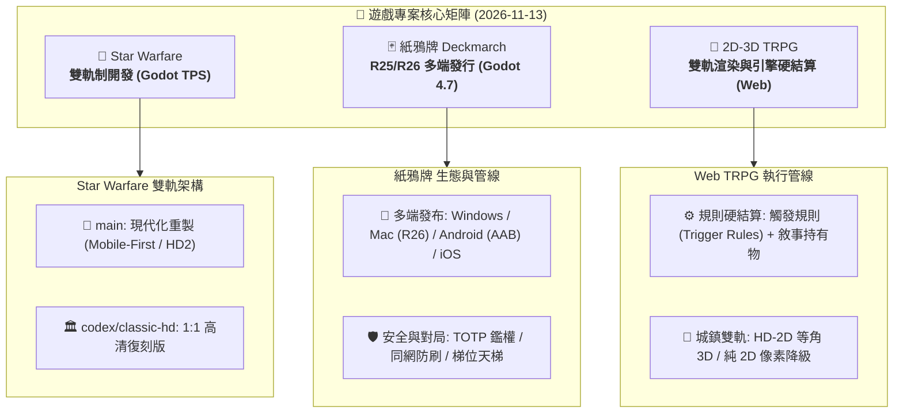
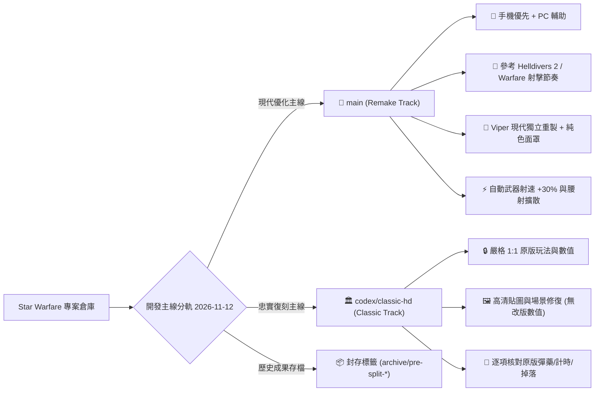
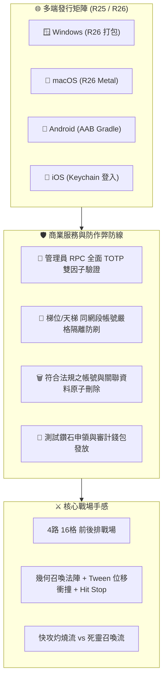
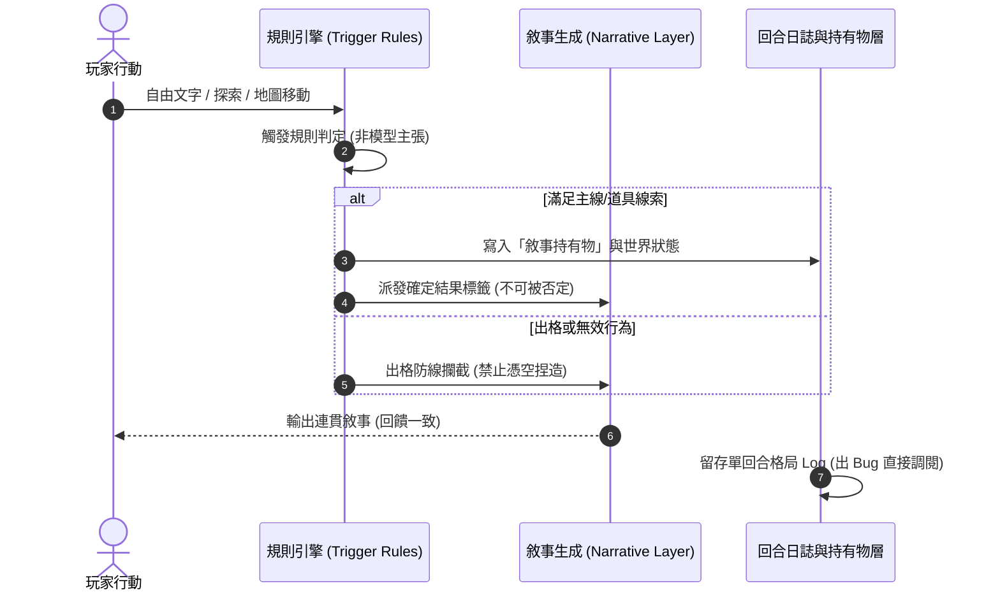

# 🎮 遊戲企劃與開發筆記總覽 (Vault Dashboard)

> [!abstract] **工作區視覺化導航**
> 本庫收錄三大核心專案之即時狀態與規格架構，全面採用視覺化圖表與矩陣呈現。

---

## 🗺️ 專案總覽拓撲圖 (Project Map)

---

## 📊 三大專案狀態矩陣 (Status Matrix)

| 專案名稱 | 最新版本 | 核心引擎 / 平台 | 當前里程碑 | 關鍵進展與驗證焦點 | 詳情連結 |
| :--- | :--- | :--- | :--- | :--- | :--- |
| **🚀 Star Warfare** | `v0.7` (雙軌定案) | Godot 4.x (Angle/Compat) | 雙軌分支分割完成 | `main` 現代重製 vs `classic-hd` 1:1 復刻；裝甲流水線與工蟲 AI 落地 | [[Notion/🎮StarWarfare企劃\|專案詳情]] |
| **🃏 紙鴉牌 Deckmarch** | `R26` (Client) / `R25` (Server) | Godot 4.7.2 Forward+ / Multi | 多平台商用驗收 | Android AAB 包、iOS 原生 Keychain、TOTP 管理鑑權、同網防刷 | [[Notion/HD-2D 卡牌對戰 (暫定) - 遊戲設計文件 v2.0\|專案詳情]] |
| **🎲 2D-3D RPG / TRPG** | `v2.4` (24 場實測) | trpg-server + WebGL/Canvas | 第二章直開 + 觸發結算 | 主線線索引擎硬結算、敘事持有物、結構化回合紀錄、HD-2D 城鎮雙軌 | [[Notion/專案名稱：(待定) 2D-3D 動作 RPG 企劃案\|專案詳情]] |

---

## 🚀 1. Star Warfare：雙軌開發架構

---

## 🃏 2. 紙鴉牌 (Deckmarch)：商用發布與安全架構

---

## 🎲 3. Web TRPG / 2D-3D 動作 RPG：引擎硬結算與城鎮管線

### 📜 TRPG 實測驗收直達看板

| 場次代號 | 驗收核心 | 成果與狀態 | 跳轉連結 |
| :--- | :--- | :--- | :--- |
| **RUN-024** | 訪客第二章直接開局 | 🟢 驗證通過（跳過第一章重複成本，主線觸發規則鎖定） | [[Notion/專案名稱：(待定) 2D-3D 動作 RPG 企劃案/TRPG測試/README#📜-實測場次索引-session-runs\|📄 查看索引]] |
| **RUN-022** | 密室與場景物件修復 | 🟢 驗收通過（場上物件不再誤判為「你沒有」，密室收束解除） | [[Notion/專案名稱：(待定) 2D-3D 動作 RPG 企劃案/TRPG測試/README#📜-實測場次索引-session-runs\|📄 查看索引]] |
| **RUN-015** | 第一章交劍與持有物 | 🟢 BUG-09 通過（新增敘事持有物層，不看措辭定成敗） | [[Notion/專案名稱：(待定) 2D-3D 動作 RPG 企劃案/TRPG測試/README#📜-實測場次索引-session-runs\|📄 查看索引]] |
| **RUN-001~03**| 酒館啟程與磨坊蜘蛛 | 🟡 早期基準場次（確立出格防線、部位耐傷與擲骰原則） | [[Notion/專案名稱：(待定) 2D-3D 動作 RPG 企劃案/TRPG測試/場次/RUN-001-銀蹄酒館/結果與觀察\|📄 檢視 RUN-001]] |

---

## 💡 Obsidian 專用語法與閱讀提示

> [!tip] **最佳閱讀體驗設定**
> 1. **大綱導航（Outline）**：按 `Ctrl + Shift + E` 或點擊右側欄的大綱圖標，可在長篇文件（如 StarWarfare 企劃或 Bug 表）中瞬間跳轉章節。
> 2. **雙鏈懸停預覽（Page Preview）**：滑鼠移至任意 `[[雙括號連結]]` 上，按住 `Ctrl` 即可在不離開當前頁面的情況下快速預覽目標文檔內容。
> 3. **折疊區塊（Foldable Headings / Callouts）**：文件中標有帶有小箭頭的標題與 Callout 區塊均可點擊折疊收起，減少視覺干擾。
> 4. **標籤面板（Tags）**：可透過右側欄標籤面板快速按 `#trpg`、`#bug-tracker`、`#gamedesign` 進行主題篩選。

